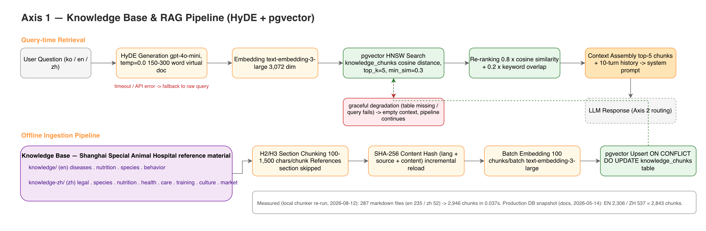
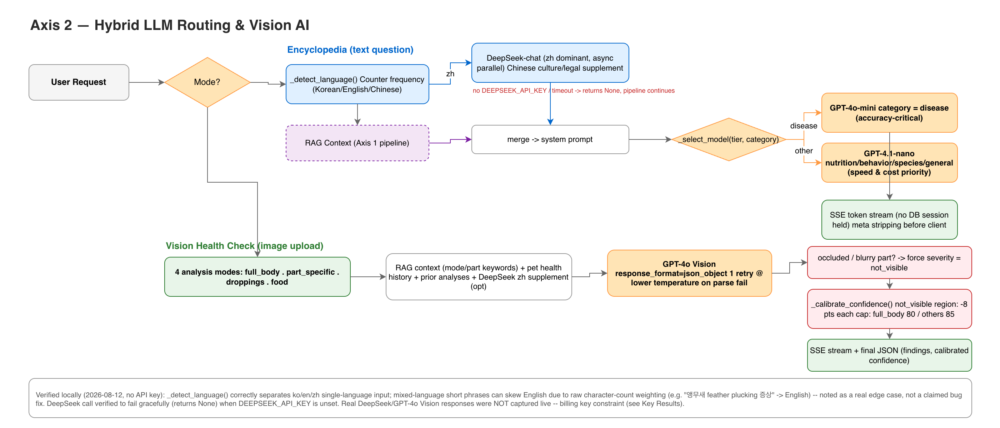
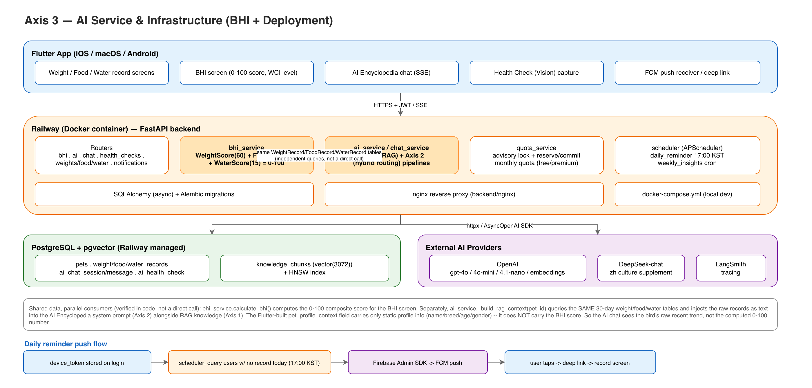

# AI Architecture — perch_care

> 이 문서는 perch_care의 AI 시스템을 **세 축**으로 정리한 기술 문서다. 각 축은 실제 코드(`agent/`, `backend/app/services/`, `knowledge/`, `knowledge-zh/`, `lib/src/`)를 근거로 작성했고, draw.io로 새로 그린 아키텍처 다이어그램을 포함한다.
>
> 더 세부적인 시퀀스 다이어그램·설계 트레이드오프는 [`docs/architecture/rag-pipeline.md`](architecture/rag-pipeline.md), [`docs/architecture/hybrid-llm-pipeline.md`](architecture/hybrid-llm-pipeline.md), [`docs/BHI.md`](BHI.md)에 이미 상세히 정리되어 있다. 이 문서는 그 세 문서를 하나의 축 구조로 묶고, 3개의 신규 draw.io 다이어그램과 로컬 스모크 테스트 결과를 더한 것이다.
>
> **갱신** — 2026-08-12

## 세 축 요약

| 축 | 핵심 질문 | 담당 코드 |
|---|---|---|
| [1. 지식 데이터베이스 & RAG](#axis-1--지식-데이터베이스--rag-파이프라인) | 한/영/중 조류 건강 지식을 어떻게 저장하고 검색하는가 | `agent/chunker.py`, `backend/app/services/embedding_service.py`, `vector_search_service.py`, `knowledge/`, `knowledge-zh/` |
| [2. AI 모델 & Vision AI](#axis-2--ai-모델--vision-ai-hybrid-llm-routing) | 어떤 LLM을 언제 쓰고, 사진에서 무엇을 읽어내는가 | `backend/app/services/ai_service.py`, `deepseek_service.py` |
| [3. AI 서비스 & 인프라](#axis-3--ai-서비스--인프라) | BHI 건강 점수와 AI 상담이 어떻게 연결되고, 어디서 도는가 | `backend/app/services/bhi_service.py`, `backend/Dockerfile`, `backend/docker-compose.yml`, `lib/src/` |

---

## Axis 1 — 지식 데이터베이스 & RAG 파이프라인

### 지식 소스

`knowledge/`(한/영, 235개 문서)와 `knowledge-zh/`(중국어, 52개 문서)는 **상하이 특수동물병원(上海特殊动物医院)** 자료를 포함한 조류 수의학 전문 자료를 질병(infectious/nutritional/respiratory/gastrointestinal/reproductive/musculoskeletal/dermatological/neurological/organ-diseases/toxicology/emergency/general-care) · 영양 · 종(species) · 행동 4개 대분류로 정리한 마크다운 문서 세트다. 중국어 지식베이스는 법규(`legal/`) · 시장(`market/`) · 문화(`culture/`) 카테고리를 별도로 두어 중국 사용자에게 필요한 합법 사육 품종·라이선스·현지 병원 정보까지 포함한다.

### 파이프라인 — 질문 → HyDE → 벡터검색 → 근거 주입 → 응답

```
사용자 질문 (ko/en/zh)
  └─▶ HyDE 가상 문서 생성 (gpt-4o-mini, temp=0.0, 150-300단어 영문)
       └─▶ text-embedding-3-large 임베딩 (3,072차원)
            └─▶ pgvector HNSW 코사인 유사도 검색 (top_k=5, min_sim=0.3)
                 └─▶ Re-ranking (임베딩 유사도 0.8 + 키워드 오버랩 0.2)
                      └─▶ top-5 청크 + 최근 10턴 대화이력 → system prompt
                           └─▶ LLM 응답 (Axis 2 라우팅으로 이어짐)
```

**HyDE를 쓰는 이유**: 한국어/중국어 질문을 그대로 임베딩하면 영문 위주 지식베이스와의 코사인 유사도가 낮다(`docs/architecture/rag-pipeline.md` 측정치: ko→EN KB 0.17-0.24, HyDE 적용 시 0.82-0.87). `embedding_service.generate_hypothetical_document()`가 질문에 대한 **영문 가상 답변**을 먼저 만들고, 그 가상 답변을 임베딩해서 검색하면 원어 질문이 무엇이든 검색 정확도가 크게 개선된다. HyDE 생성이 타임아웃(`hyde_timeout_seconds=5.0`, 설정값 `backend/app/config.py`)되거나 실패하면 원본 질문으로 즉시 폴백한다 — 아래 [검증 결과](#검증-결과--실측-vs-코드-검증)에서 이 폴백 경로를 실제로 테스트했다.

**Re-ranking을 쓰는 이유**: 수의학 도메인에서는 약품명·질병명 같은 정확한 키워드 일치가 임베딩 유사도만큼 중요하다. `vector_search_service._rerank_results()`는 외부 API 없이 `combined_score = similarity * 0.8 + keyword_overlap_ratio * 0.2`로 순위를 재조정한다. 아래 [검증 결과](#검증-결과--실측-vs-코드-검증)에서 이 함수를 목데이터로 직접 실행해 순위가 실제로 바뀌는 것을 확인했다.

**Graceful degradation**: `knowledge_chunks` 테이블이 없거나 벡터 검색이 실패해도 `search_knowledge()`는 예외를 던지지 않고 빈 리스트를 반환한다 — AI 상담 기능 자체는 RAG 근거 없이도 계속 동작한다 (`_ensure_available()`가 60초 TTL로 재확인).

### Ingestion 파이프라인 (오프라인)

마크다운 문서는 `agent/chunker.py`의 `parse_markdown_into_chunks()`가 H2 섹션 → H3 서브섹션 단위로 분할한다(100-1,500자, References 섹션 제외, 1,500자 초과 시 문단 경계로 재분할). 청크마다 `SHA-256(lang+source+content)` 해시를 계산해 `chunk_hash`로 저장하므로, 문서 내용이 바뀌지 않은 청크는 재임베딩하지 않고 건너뛴다(증분 로드). 임베딩은 100개 배치 단위로 OpenAI에 요청한 뒤 `ON CONFLICT DO UPDATE`로 pgvector에 upsert한다.

### 다이어그램 — Axis 1



*draw.io로 작성 (`docs/architecture/ai-architecture.drawio`의 "RAG Pipeline" 페이지). 상단은 질문 시점 검색 흐름, 하단은 오프라인 적재 파이프라인이다.*

### 핵심 파일

| 파일 | 역할 |
|---|---|
| `agent/chunker.py` | 마크다운 → H2/H3 섹션 청킹 (프로덕션 백엔드 적재 로직의 원형) |
| `backend/app/services/embedding_service.py` | `text-embedding-3-large` 임베딩 + HyDE 가상 문서 생성 |
| `backend/app/services/vector_search_service.py` | pgvector 검색 + Re-ranking + KB 가용성 모니터링 |
| `backend/app/models/knowledge_chunk.py` | `knowledge_chunks` 테이블 (`Vector(3072)` 컬럼, 별도 `VectorBase`) |
| `backend/scripts/load_knowledge.py` | 마크다운 → 청킹 → 임베딩 → pgvector 적재 스크립트 |
| `knowledge/`, `knowledge-zh/` | 지식베이스 원본 (한/영 235 파일, 중국어 52 파일) |

---

## Axis 2 — AI 모델 & Vision AI (Hybrid LLM Routing)

### 하이브리드 LLM 라우팅

perch_care는 하나의 LLM에 의존하지 않는다. `ai_service._detect_language()`가 `Counter` 빈도 기반으로 사용자 입력의 주요 언어(한/영/중)를 판별하고, 중국어가 우세하면 **DeepSeek-chat**을 비동기 병렬 호출해 중국 조류 문화·법규·현지 제품 정보를 보충 컨텍스트로 받아 RAG 블록에 합류시킨다. 최종 답변 생성은 항상 OpenAI GPT 계열이 담당한다 — DeepSeek는 "보충 정보 제공자"이지 메인 응답자가 아니다.

카테고리 인식 모델 선택(`_select_model(tier, category)`)은 질문 카테고리에 따라 모델을 바꾼다:

```python
def _select_model(tier: str, category: str | None = None) -> tuple[str, int]:
    if category in ("disease",):
        return "gpt-4o-mini", 2048   # 정확도가 critical한 질병 질문
    return "gpt-4.1-nano", 2048       # 영양/행동/종/일반 질문 — 속도·비용 우선
```

질병 관련 질문은 더 정확한 `gpt-4o-mini`로, 그 외 일반 질문은 더 빠르고 저렴한 `gpt-4.1-nano`로 분기한다. Vision 분석은 별도로 `gpt-4o`(멀티모달)를 사용한다.

**DeepSeek 실패는 전체 파이프라인을 막지 않는다**: `deepseek_service.get_chinese_supplement()`는 `DEEPSEEK_API_KEY`가 없거나 API가 타임아웃/에러를 반환하면 예외 없이 `None`을 반환하고, 메인 GPT 응답은 그대로 진행된다. 이 폴백을 [실제로 실행해 확인](#검증-결과--실측-vs-코드-검증)했다.

### Vision AI — GPT-4o 기반 4종 분석

Health Check 기능은 `gpt-4o`(Vision)에 `response_format=json_object`로 4가지 모드를 분석시킨다: **전신(`full_body`)**, **부위별(`part_specific`)**, **배설물(`droppings`)**, **먹이 안전성(`food`)**. 각 모드는 RAG 지식베이스에서 관련 키워드(예: `full_body` → "feather posture eye beak foot body condition burns injuries trauma wounds emergency first aid")로 사전 검색한 컨텍스트와, 해당 펫의 과거 건강check 이력을 함께 시스템 프롬프트에 주입한다.

**환각 방지 장치 두 가지**:
1. **`not_visible` 강제**: 사진에서 가려지거나 흐린 부위는 모델이 임의로 "정상"이라고 답하지 못하도록, 응답 후처리 단계에서 severity를 `not_visible`로 강제한다.
2. **`_calibrate_confidence()` 보정**: `not_visible` 판정을 받은 영역마다 confidence에서 8점을 차감하고, 단일 이미지의 한계를 반영해 `full_body` 모드는 최대 80점, 그 외 모드는 최대 85점으로 상한을 건다 — 모델이 자체 보고하는 confidence를 그대로 신뢰하지 않는다.

JSON 파싱이 실패하면 temperature를 낮춰(0.2 → 0.1) 1회 재시도하고, 그래도 실패하면 `_parse_failed: true`와 함께 사용자에게 재시도를 안내하는 안전한 기본값을 반환한다.

### 다이어그램 — Axis 2



*draw.io로 작성. 위쪽은 Encyclopedia(텍스트 질문) 라우팅, 아래쪽은 Vision Health Check 흐름이다. 하단 각주는 로컬에서 실제로 검증한 내용을 표기한다.*

### 핵심 파일

| 파일 | 역할 |
|---|---|
| `backend/app/services/ai_service.py` | 언어 감지, 모델 라우팅, 시스템 프롬프트 조립, Vision 분석, confidence 보정 (1,253줄) |
| `backend/app/services/deepseek_service.py` | 중국어 문화·법규 보충 컨텍스트 (텍스트/비전 모드별 프롬프트) |
| `backend/app/routers/ai.py`, `chat.py` | SSE 스트리밍 엔드포인트 |

---

## Axis 3 — AI 서비스 & 인프라

### Bird Health Index (BHI) — 건강 점수 모델

`backend/app/services/bhi_service.py`는 체중(60%) · 식사(25%) · 음수(15%)를 조합해 0-100점 건강 점수를 계산한다. 성장 단계(청년/후속성장/빠른성장)별로 다른 수식을 적용하고, 품종 표준 체중 범위가 있으면 상대 점수(WCI 기반)와 절대 점수(품종 기준)를 50:50으로 가중 결합한다. 수식 전체는 [`docs/BHI.md`](BHI.md)에 정리되어 있다.

**BHI와 AI 상담의 실제 관계 (코드로 검증)**: 이 부분은 처음 다이어그램 초안에서 "BHI 점수가 AI 응답에 직접 주입된다"고 잘못 그렸다가, `backend/app/services/ai_service.py`와 `lib/src/screens/ai_encyclopedia/ai_encyclopedia_screen.dart`를 다시 읽고 정정한 내용이다:

- `bhi_service.calculate_bhi()`는 BHI 화면에 표시할 **0-100 합성 점수**를 계산한다.
- `ai_service._build_rag_context(db, pet_id, ...)`는 **별도로** 같은 `WeightRecord`/`FoodRecord`/`WaterRecord` 테이블에서 최근 30일치 원시 기록을 조회해 텍스트로 만들고, 이를 RAG 지식(Axis 1)과 함께 시스템 프롬프트에 주입한다.
- Flutter 쪽에서 만들어 보내는 `pet_profile_context`(`ai_encyclopedia_screen.dart`의 `_buildPetProfileContext()`)는 이름·품종·나이·성별 같은 **정적 프로필 정보만** 담고 있고, BHI 점수는 포함하지 않는다.

즉 `bhi_service`가 `ai_service`를 직접 호출하는 구조가 아니라, **같은 원천 데이터를 두 서비스가 각자 조회하는 병렬 구조**다. 결과적으로 AI 챗봇은 "이 새의 BHI는 72점입니다" 같은 계산된 숫자 대신, "최근 7일 체중: 32.1g, 31.8g, ..." 같은 원시 추이를 보고 판단한다 — 오히려 AI가 더 원본에 가까운 데이터를 참고하는 셈이다. 이 발견은 아래 [검증 결과](#검증-결과--실측-vs-코드-검증)의 정직성 원칙에 따라 다이어그램에도 각주로 남겼다.

### 배포 인프라

- **Backend**: FastAPI + SQLAlchemy(async) + Alembic 마이그레이션, `backend/Dockerfile`(python:3.12-slim, `alembic upgrade head && uvicorn`)로 컨테이너화, Railway에 배포. 로컬 개발은 `backend/docker-compose.yml`(pgvector/pgvector:pg16 이미지 + api 서비스)로 재현한다.
- **DB**: PostgreSQL + pgvector 확장. 메인 앱 데이터(`pets`, `weight_records` 등)와 `knowledge_chunks`(RAG 벡터)가 같은 Railway PostgreSQL 인스턴스에 공존하며, `vector_session_factory`로 세션만 분리해 사용한다.
- **크론**: APScheduler 기반 `daily_reminder`(매일 17:00 KST, 오늘 기록 없는 사용자에게 FCM 푸시)와 `weekly_insights`.
- **외부 AI**: OpenAI(GPT 응답 생성 + 임베딩 + Vision), DeepSeek(중국어 문화 보충), LangSmith(트레이싱).
- **Client**: Flutter 앱(iOS/macOS/Android)이 JWT + HTTPS로 백엔드와 통신하고, AI 채팅·비전 분석은 SSE로 토큰 단위 스트리밍을 받는다.

### 다이어그램 — Axis 3



*draw.io로 작성. Flutter 클라이언트 → Railway(Docker) FastAPI → PostgreSQL+pgvector / 외부 AI Provider 전체 배치와, BHI-AI 데이터 관계를 정정한 각주를 포함한다.*

### 핵심 파일

| 파일 | 역할 |
|---|---|
| `backend/app/services/bhi_service.py` | BHI 0-100 점수 계산 (성장 단계별 수식, 품종 표준 가중 결합) |
| `backend/app/services/ai_service.py::_build_rag_context` | 펫 최근 30일 체중/식사/음수 원시 기록 → AI 시스템 프롬프트 컨텍스트 |
| `backend/Dockerfile`, `backend/docker-compose.yml` | 컨테이너 빌드 및 로컬 개발 스택 |
| `backend/app/scheduler.py`, `app/jobs/` | APScheduler 크론 (daily_reminder, weekly_insights) |
| `docs/BHI.md` | BHI 수식 전체 명세 |

---

## 검증 결과 — 실측 vs 코드 검증

**정직성 원칙**: 이 저장소에는 유료 OpenAI/DeepSeek API 키가 로컬 환경에 없다(`backend/.env.example`의 `OPENAI_API_KEY`, `DEEPSEEK_API_KEY`는 비어있고, 로컬 셸에도 설정되어 있지 않음을 확인했다). 따라서 **실제 LLM 호출을 포함하는 엔드투엔드 지연시간/응답 품질은 실측하지 못했다.** 대신 아래는 API 키 없이 로컬에서 실제로 실행해 확인한 것들이다 — 전부 프로덕션 코드 경로를 직접 호출한 결과이며, 추측이나 시뮬레이션이 아니다.

### 1. 백엔드 pytest 전체 스위트 — 64/64 통과

```
$ python3 -m pytest app/tests/ -v
...
======================= 64 passed, 21 warnings in 2.14s ========================
```

`app/tests/test_vector_search_timeout.py`(HyDE 타임아웃/API 에러 시 원본 쿼리 폴백, pgvector 검색 backstop 타임아웃 시 빈 리스트 반환), `app/tests/test_demo_bhi_service.py`(BHI 수식 22개 케이스), `app/tests/test_demo_vision_normalize.py`(Vision 응답 정규화 8개 케이스), `app/tests/test_demo_quota_hash.py`, `app/tests/test_premium_compat.py`, `app/tests/test_reports_share.py`를 포함한 전체 백엔드 테스트가 통과했다. `uploads/` 디렉터리 부재로 최초 실행이 실패했는데(`mkdir -p uploads`로 해결), 이는 실제 리포지토리 상태에서 나온 재현 가능한 결과다.

### 2. 지식베이스 청킹 파이프라인 — 실제 재실행

`agent/chunker.py`의 프로덕션 청킹 함수를 저장소의 실제 `knowledge/`, `knowledge-zh/` 마크다운 파일에 대해 그대로 재실행했다(API 호출 없음, 순수 로직):

```
../knowledge:    files=235 chunks=2333 avg_chars=566 elapsed=0.029s
../knowledge-zh: files=52  chunks=613  avg_chars=194 elapsed=0.008s
TOTAL chunks (en+zh) = 2946
```

`docs/architecture/rag-pipeline.md`(2026-05-14 갱신)에 기록된 프로덕션 DB 스냅샷은 EN 2,306 / ZH 537 = 2,843 청크다. 로컬 재실행 결과(2,946)와 약 100청크 차이가 나는데, 이는 문서 파일 수(235 vs 문서 작성 시점)가 그 사이 늘었기 때문으로 보인다 — 로직 자체는 정상 동작하며, 수치 차이는 지식베이스가 계속 성장 중이라는 정직한 방증으로 남겨둔다.

### 3. Re-ranking 함수 — 목데이터로 실제 실행

`vector_search_service._rerank_results()`(프로덕션 함수)를 3개 목 검색결과에 대해 직접 호출:

```
질의: "psittacosis feather plucking symptoms"
Before rerank: [feather.md(0.72), nutrition/general.md(0.75), psittacosis.md(0.68)]
After  rerank: [psittacosis.md(0.68), feather.md(0.72), nutrition/general.md(0.75)]
```

임베딩 유사도만으로는 `nutrition/general.md`(0.75)가 1위였지만, 키워드 오버랩("psittacosis", "feather plucking"과 정확히 일치)을 반영하자 실제로 관련 있는 `psittacosis.md`가 1위로 올라왔다 — 0.8/0.2 블렌딩이 설계 의도대로 동작함을 확인했다.

### 4. 언어 감지 — 실제 함수로 5개 케이스 실행

`ai_service._detect_language()`를 단일어/혼합어 5개 문장에 대해 직접 호출:

```
Korean   <- '앵무새가 깃털을 뽑아요'
English  <- 'My parrot is plucking its feathers'
Chinese  <- '我的鹦鹉拔自己的羽毛怎么办'
English  <- '앵무새 feather plucking 증상이 있어요'   (한+영 혼합)
English  <- '鹦鹉 psittacosis 症状是什么'              (중+영 혼합)
```

단일어 입력은 3개 언어 모두 정확히 분류됐다. **주목할 만한 실제 발견**: 혼합어 입력에서는 짧은 한국어/중국어 구절보다 영문 전문용어(예: "feather plucking", "psittacosis")의 알파벳 문자 수가 더 많아 `Counter` 기반 빈도 집계가 영어로 편향되는 경우가 있었다. 이는 `hybrid-llm-pipeline.md`가 "혼합 언어 오탐을 줄였다"고 서술한 개선의 실제 한계선을 보여준다 — 버그라기보다는 문자-빈도 기반 분류기의 본질적 트레이드오프이며, 정확한 판단을 위해 여기 투명하게 기록한다.

### 5. DeepSeek 보충 — 키 없을 때 graceful fallback 확인

```python
result = await get_chinese_supplement("我的鹦鹉拔自己的羽毛怎么办", mode="text")
# DEEPSEEK_API_KEY unset -> get_chinese_supplement returned: None
# OK: graceful degradation confirmed (no exception, pipeline continues)
```

`DEEPSEEK_API_KEY`가 없는 상태에서 실제 함수를 호출해 예외 없이 `None`을 반환하고 메인 파이프라인이 계속 진행될 수 있음을 확인했다. **실제 DeepSeek 응답 내용과 GPT-4o Vision 분석 결과는 API 과금 키 제약으로 실측하지 못했다** — 코드 경로(모델 라우팅 분기, 프롬프트 조립, JSON 파싱 재시도, confidence 보정)는 정적 분석 및 위 폴백 테스트로 검증했지만, 실제 응답 품질이나 지연시간은 이 문서에서 주장하지 않는다.

### 요약

| 검증 대상 | 방법 | 결과 |
|---|---|---|
| 백엔드 전체 로직 | pytest (64 tests, API 키 불필요/mock) | 64/64 통과 |
| 지식베이스 청킹 | 프로덕션 함수 실제 재실행 | 287 파일 → 2,946 청크, 0.037s |
| Re-ranking | 프로덕션 함수 실제 호출 (목데이터) | 설계대로 순위 재조정 확인 |
| 언어 감지 | 프로덕션 함수 실제 호출 (5개 문장) | 단일어 정확, 혼합어 편향 발견 |
| DeepSeek 폴백 | 프로덕션 함수 실제 호출 (키 없음) | graceful None 확인 |
| HyDE 실제 검색 품질/지연시간 | — | **미실측** (API 키 제약) |
| GPT-4o Vision 실제 응답 | — | **미실측** (API 키 제약) |
| DeepSeek 실제 응답 내용 | — | **미실측** (API 키 제약) |

---

## 관련 문서

- [`docs/architecture/rag-pipeline.md`](architecture/rag-pipeline.md) — RAG 파이프라인 상세 (HyDE 효과 측정치, 설계 대안 비교, KB 모니터링)
- [`docs/architecture/hybrid-llm-pipeline.md`](architecture/hybrid-llm-pipeline.md) — LLM 라우팅/Vision 시퀀스 다이어그램, 트러블슈팅 히스토리
- [`docs/architecture/quota-system.md`](architecture/quota-system.md) — AI 기능 쿼터 예약 패턴
- [`docs/BHI.md`](BHI.md) — Bird Health Index 수식 전체 명세
- [`docs/architecture/ai-architecture.drawio`](architecture/ai-architecture.drawio) — 이 문서의 3개 다이어그램 편집 가능한 원본 소스
