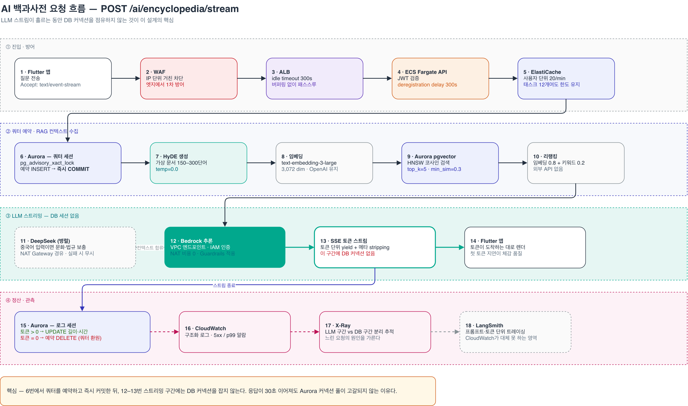
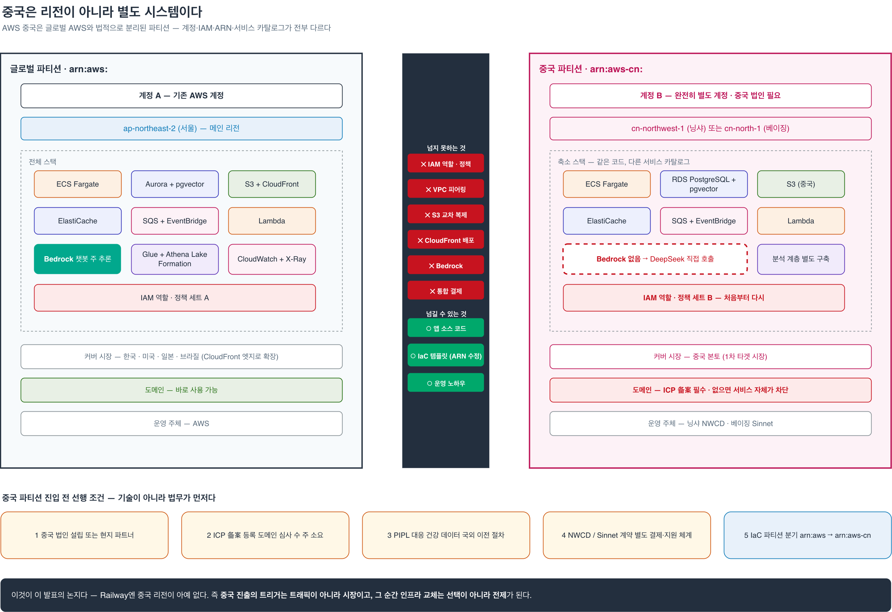
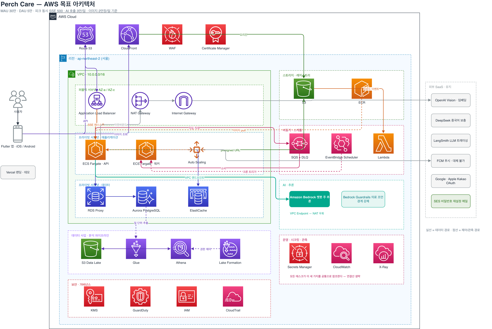
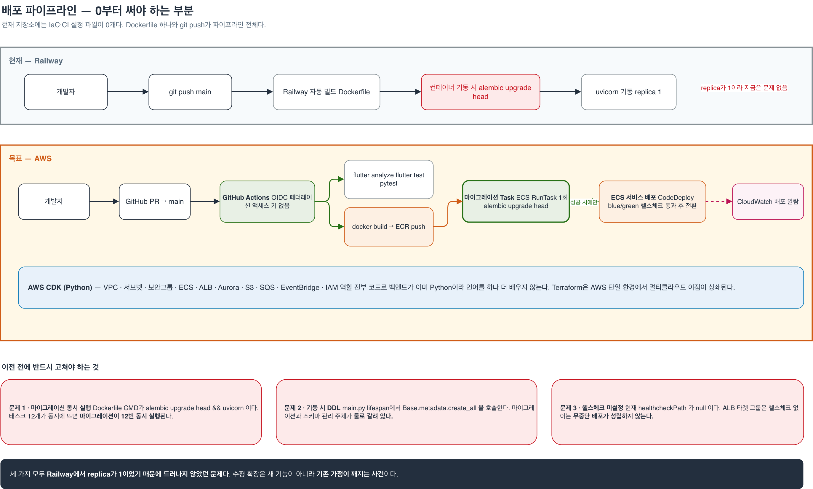
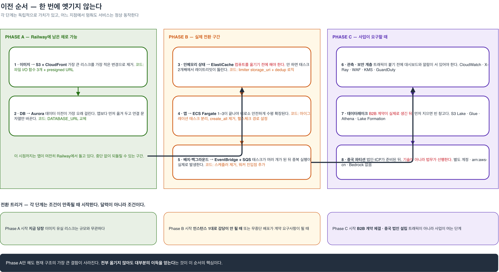

# AI 앱 서비스를 위한 AWS 아키텍처 — 발표 원고 (Perch Care)

> AWS Student Builder Group · 2026-09 · 임동현
> 구성: **Part 1** (01–26) Perch Care 사례 발표 · **Part 2** (B01–B18) Bedrock 교육.
> 슬라이드 1장 = `##` 섹션 하나. `**말할 것**`은 발표 멘트 요지, `> 노트`는 질문 대비용.
> 다이어그램 원본: [aws-target-architecture.drawio](../architecture/aws-target-architecture.drawio) (5페이지) · PNG는 투명 배경.

---

## 01. 표지

# AI 앱 서비스를 위한 AWS 아키텍처

실제 운영 중인 서비스 하나를 놓고 — 컴퓨트부터 데이터·LLM까지 설계해보기

2026 · 임동현 · AWS Student Builder Group

**말할 것**
"인스턴스 한 대, 월 $20, p99 32ms. 이게 언제 답이 아니게 될까요?" — 오늘 발표는 이 질문 하나에 숫자로 답하는 자리입니다.

---

## 02. Perch Care 소개

**말할 것**
반려조 건강관리 앱입니다. 기록하면 점수가 나오고, AI에게 물어볼 수 있습니다. AI 호출이 곧 핵심 기능이고 1차 시장이 중국이라서 — "AWS 일반론"이 아니라 "제약이 있는 실제 문제"로 설계를 이야기할 수 있습니다.

| | |
|---|---|
| 무엇 | 체중·식사·음수량 기록 → **Bird Health Index (0–100)** |
| AI | 백과사전 챗봇(앵박사) · 사진 건강체크(Vision) · 주간 인사이트 리포트 |
| 언어 | 한국어 · 영어 · 중국어 |
| 상태 | **App Store 정식 출시** · 1인 개발 · 실사용자 운영 중 · 랜딩 perch.ai.kr |
| 스택 | Flutter · FastAPI · PostgreSQL 17 + pgvector · OpenAI / DeepSeek · LangSmith · FCM |

- 왜 이 앱인가: **AI 호출 = 핵심 기능**, **1차 타겟 = 중국** → 컴퓨트·리전·LLM·규제가 한 서비스 안에서 전부 얽힘

---

## 03. 지금 돌아가고 있는 것 — 계층 지도

**말할 것**
발표 전체의 기준점입니다. 추정이 아니라 저장소 코드에서 그대로 뽑았습니다. 오른쪽 열의 코드 위치가 근거입니다.

| 계층 | 구성 | 코드 근거 |
|---|---|---|
| **클라이언트** | Flutter iOS/Android · Riverpod MVVM · 오프라인 SyncService 큐(실패 시 로컬 저장 → 재시작 시 재전송) | `lib/src/services/sync/sync_service.dart` |
| **앱** | FastAPI + uvicorn **단일 프로세스** · Docker · **replica 1** | `backend/Dockerfile` — `CMD alembic upgrade head && uvicorn` |
| **앱 내부 상태** | slowapi **인메모리** 레이트리밋 · 인사이트 중복방지 전역 `set` · `/uploads` **StaticFiles 직접 서빙** | `app/limiter.py` · `app/routers/pets.py:162` · `app/main.py:86` |
| **데이터** | PostgreSQL 17 · pgvector **3,072차원** HNSW · 청크 **2,843건** · 업로드는 컨테이너 로컬 디스크 | `app/models/knowledge_chunk.py:19` |
| **배치·백그라운드** | APScheduler(앱 프로세스 안, 03:00 UTC 이미지 정리) · `asyncio.create_task` 주간 인사이트 · Railway Cron 일간 알림 · FCM v1 HTTP **동기 루프** | `app/scheduler.py` · `app/services/push_service.py:39` |
| **외부** | OpenAI · DeepSeek(`api.deepseek.com`) · LangSmith · FCM · Vercel 랜딩 · Apple/Google/Kakao OAuth | `.env.example` — 환경변수 34개 |
| **배포** | GitHub `main` push → Railway 자동 배포 · **IaC 0개** · `.github/workflows/` 없음 | — |

> 노트: "앱 내부 상태" 줄이 뒤에서 계속 등장합니다. replica가 1이라서 지금은 아무 문제가 없고, 2가 되는 순간 전부 깨지는 항목들입니다.

---

## 04. 지금 돌아가고 있는 것 — AI 파이프라인 (하이브리드 LLM)

**말할 것**
AI 부분만 따로 봅니다. 모델이 하나가 아니라 질문 종류·언어에 따라 갈립니다. 이게 뒤에서 "Bedrock으로 무엇을 옮기고 무엇을 남기나"의 기준이 됩니다.

```
사용자 요청
 ├─ Encyclopedia(텍스트) ─ 언어 감지(Counter 빈도)
 │     ├─ 중국어 dominant → DeepSeek 병렬 호출 (중국 조류 문화·법규 보충 → system prompt 합류)
 │     ├─ RAG: HyDE → text-embedding-3-large → pgvector HNSW → 리랭킹
 │     └─ _select_model(category)
 │           ├─ disease              → gpt-4o-mini  (정확도 우선)
 │           └─ nutrition/behavior/… → gpt-4.1-nano (속도·비용 우선)
 └─ Vision Health Check(이미지) ─ 언어 감지(_resolve_language)
       ├─ 중국어 → DeepSeek 병렬 호출 (mode별 프롬프트: 배변·사료·외상·중독 등 중국 특유 맥락 보충)
       ├─ RAG: search_knowledge(mode, 부위) + 펫 건강 이력 + 과거 분석
       └─ gpt-4o Vision (RAG 근거 + 이미지 → not_visible 강제 + confidence 보정)
```

- **DeepSeek는 텍스트·이미지 공통**: 중국어 사용자면 두 모드 모두에서 병렬로 호출 → 결과는 system prompt에 합류만 하고 최종 판단은 GPT가 함. 실패하면 `None`으로 조용히 빠짐 (→ 22번 실사례)

- **SSE 안전장치**: Quota 세션(advisory lock + INSERT + **즉시 COMMIT**) → LLM 스트림 구간엔 **DB 세션 0** → Log 세션(UPDATE). 토큰 0이면 예약 row 삭제 = 쿼터 환원
- **월간 쿼터**: 백과사전 30회(429) · 비전 10회(403) — LLM 비용 안전장치
- **트레이싱**: LangSmith 비동기 사이드카
- 상세: [hybrid-llm-pipeline.md](../architecture/hybrid-llm-pipeline.md) · [rag-pipeline.md](../architecture/rag-pipeline.md) · [quota-system.md](../architecture/quota-system.md)

---

## 05. 지금 돌아가고 있는 것 — 요청 한 건이 지나는 길

**말할 것**
`POST /ai/encyclopedia/stream` 한 건이 18단계를 지납니다. 6번에서 쿼터를 예약하고 바로 커밋하기 때문에, 12–13번 스트리밍 구간에는 DB 커넥션이 없습니다. 이 성질이 뒤에서 RDS Proxy·Fargate 결정에 그대로 이어집니다.



> 캡션: 6번 쿼터 예약 → 즉시 커밋 / 12–13번 스트리밍 구간 DB 커넥션 없음

---

## 06. 지금은 어떤 환경에서 돌아가는가

**말할 것**
Railway 한 대입니다. 아래 수치는 2026-09-16 Railway CLI로 직접 측정한 값입니다.

| 항목 | 값 |
|---|---|
| 플랫폼 | Railway (PaaS) · Docker · **replica 1** |
| 리전 | `us-west2` (미국 서부) |
| 월 인프라 비용 | **$20** |
| 요청량 | **23 req / 시간** |
| 응답 p99 | **32 ms** |
| 메모리 / CPU | 272 MB / ≈ 0 % |
| 배치 | Railway Cron(일간 알림) + APScheduler(앱 안) |
| 배포 파이프라인 | `git push` 한 줄. 배포 자산 = `Dockerfile` 하나 |
| IaC | **0개** |
| 주변 | Vercel(랜딩) · App Store / Play · FCM |

---

## 07. 이 환경을 쓰는 이유 — 비용 · 문제 · 운영

**말할 것**
"왜 아직 AWS가 아닌가"에 세 줄로 답합니다. 대부분의 비교표는 첫 열(비용)만 적고 셋째 열(운영)을 빼먹습니다.

| | 비용 | 문제 | 운영 |
|---|---|---|---|
| **현재** | **$20 / 월** | 시간당 23건 · p99 32ms · CPU ≈0% | 운영에 쓰는 시간 **0** · IaC 0 |
| **AWS 최소구성이면** | **≈ $105 / 월 (5.3배)** — NAT GW $45 = **43%** · RDS 21% · ALB 17% · Fargate 10% · 기타 9% | 오토스케일 · 로드밸런서 · 읽기 복제본 · 분산 캐시 · 멀티 AZ → **해결할 문제가 존재하지 않음** | VPC·서브넷·라우팅 · SG/NACL · ECR·ECS 태스크정의·서비스 · ALB 리스너·타겟그룹·ACM · IAM 역할·OIDC · CloudWatch 로그그룹·알람 — **전부 0부터** |
| **해석** | 트래픽이 작을수록 **고정비(NAT)** 비중이 커진다 | 없는 문제를 위해 복잡도를 사는 건 설계가 아니라 낭비 | PaaS 프리미엄의 실체 = 서버 값이 아니라 **내가 안 써도 되는 YAML의 양** |

**결론: Railway는 타협이 아니라 현재 제약에서의 최적해. 그리고 최적해는 제약이 바뀌면 같이 바뀐다.**

> 노트: AWS $105 내역 — Fargate 0.25vCPU×1 $10 · ALB $18 · RDS t4g.micro $22 · NAT ×1 $45 · S3+CloudFront $3 · ECR/CloudWatch/Secrets $7. NAT가 필요한 이유는 OpenAI·DeepSeek·LangSmith·FCM·OAuth 전부 아웃바운드 필수라서.

---

## 08. 그럼 왜 AWS로 설계하는가

**말할 것**
트래픽 때문이 아닙니다. 실무에서 클라우드를 바꾸는 이유는 대개 **시장·계약·규제** 쪽입니다. 그리고 설계 기준을 임의로 키우면 질문 한 번에 무너지니까, 사업계획서 목표에서 유도합니다.

**설계 기준 (사업계획서 2028년 5개국 목표에서 유도)**

| 지표 | 설계 기준 | 유도 근거 |
|---|---|---|
| 누적 다운로드 | 1,000,000 | 한·중·미·일·브라질 SOM 합산 |
| **MAU** | **300,000** | 다운로드 대비 30% 잔존 |
| **DAU** | **50,000** | 일일 기록 앱 통상 17% |
| 피크 동시 SSE 스트림 | 500 | DAU의 1%가 동시에 AI 대화 |
| **AI 호출 / 일** | **30,000** | DAU의 60%가 하루 1회 |
| 이미지 업로드 / 일 | 20,000 | 평균 500KB → 일 10GB |

다음 3장이 이 발표의 핵심 — **AWS를 부르는 트리거 3개**입니다.

---

## 09. 트리거 1 — 시장 진입: 중국

**말할 것**
1차 타겟이 중국인데 서버는 미국 서부에 있습니다. 그리고 이건 "리전을 하나 추가"하는 문제가 아닙니다.

- **Railway 리전**: 미국 2 · 유럽 1 · 싱가포르 1 — **한국·중국·일본 없음**. 중국 리전은 앞으로도 생길 수 없음(아래 이유)
- **중국 사용자의 현재 경로**: 태평양 왕복 + GFW 통과 → 지연·불안정. **ICP 备案 없는 도메인은 차단**
- **AWS 중국 = 별도 파티션**

| 항목 | 글로벌 AWS | AWS 중국 |
|---|---|---|
| 계정 | 기존 계정 | **완전히 별도 계정** · 중국 법인 필요 |
| 운영 주체 | AWS | 베이징 = Sinnet · 닝샤 = NWCD |
| IAM | — | **크로스 파티션 불가** · 역할·정책 별도 |
| ARN | `arn:aws:` | **`arn:aws-cn:`** · IaC 코드가 그대로 안 돎 |
| Bedrock | 사용 가능 | **미제공** → LLM 전략이 갈림 |
| 데이터 이전 | 자유 | PIPL · 건강 데이터 국외 이전 별도 절차 |

- **LLM 전략이 갈린다**: 중국 안에서 OpenAI 호출 불가 → **DeepSeek 직접 API가 양쪽 파티션의 유일한 공통 경로** (11-C에서 다시)



> 노트: 목표 메인 리전은 `ap-northeast-2` 서울(본사·일본 지연 양호·미주는 CloudFront) + 중국 파티션 별도. "글로벌 서비스는 AWS 계정이 하나가 아닐 수 있다"가 이 장의 한 줄.

---

## 10. 트리거 2 — B2B 계약 요구사항

**말할 것**
수의사 SaaS, 보험사 데이터 딜. 이 계약서들이 요구하는 항목은 돈으로 해결되는 게 아니라 **문서와 기능**입니다.

| 계약서가 요구하는 것 | AWS에서 대응 | Railway에서 |
|---|---|---|
| SLA 문서 | 서비스별 SLA · Health Dashboard | 플랫폼 SLA만 |
| 감사 로그 ("누가 언제 무엇을") | **CloudTrail** + Bedrock 모델 호출 로깅 | 없음 |
| 저장 암호화 · 키 관리 | **KMS** 고객 관리 키 · 키 폐기 = 데이터 파기 증명 | 플랫폼 기본 암호화, 키 통제 불가 |
| 최소 권한 접근 | **IAM** 태스크 역할 분리 (API용 / 워커용) | 팀 단위 권한 |
| 컴플라이언스 리포트 | **AWS Artifact** (SOC · ISO 보고서 다운로드) | 고객에게 전달할 문서 없음 |
| 파트너별 행·열 단위 데이터 권한 | **Lake Formation** | 대응물 없음 |

- **데이터 라이선싱 수익 축** (사업계획서 4축 중 하나): 현재 아키텍처에 **분석 계층이 0** → S3 Data Lake → Glue(익명화 ETL) → Athena(파트너 SQL) → Lake Formation
- 컴퓨트·DB는 "Railway로도 되는데 왜?"가 항상 따라오지만, **데이터레이크·Athena·Lake Formation은 대응물이 아예 없음** — AWS 정당화의 가장 강한 카드

---

## 11. 트리거 3 — 규제 · 데이터 주권

**말할 것**
건강 데이터는 민감 정보입니다. "데이터가 어디에 있는가"를 계약서에 쓸 수 있어야 하고, 그러려면 리전 선택권과 보존·삭제 정책이 인프라 층에 있어야 합니다.

- **중국 PIPL**: 건강 데이터 = 민감 개인정보. 국외 이전 시 안전평가 / 표준계약 절차. 현실적 답 = **중국 데이터는 중국 파티션 안에**
- **한국 개인정보보호법**: 국외 이전 고지·동의. 현재 `us-west2` 서버는 그 자체가 국외 이전
- **리전 선택권 = 규제 대응 수단**: 서울 리전 + 중국 파티션 → "국내 저장"을 문서로 약속 가능. Railway는 리전 4개 중 선택, 데이터 위치 계약 불가
- **보존·삭제도 인프라로**: S3 수명주기(30일 자동 삭제) · Object Lock(보존 증명) · KMS 키 폐기(암호학적 파기)
- Bedrock **Geo 크로스리전 프로필**: 데이터 잔류 요구 시 APAC 안에서만 라우팅

**실사례 — 출시 때 이미 한 번 부딪혔습니다**

| | 지금 (외부 API) | Bedrock이면 |
|---|---|---|
| 실제 데이터 흐름 | 질문·건강체크 이미지가 **OpenAI(미국)** · 중국어 보충은 **DeepSeek(중국)** 서버로 나감 | 추론이 **내 AWS 계정·리전 안**에서 실행. 프롬프트·이미지는 저장·학습에 쓰이지 않음 |
| 개인정보처리방침 문구 | 출시 심사 과정에서 OpenAI를 명시하지 못해 **"Perch가 직접 설계·운영하는 AI 모델 서비스"**로 수정 → 실제 흐름과 문구 사이에 **간극** | "직접 운영하는 AI 서비스"가 **사실 그대로**가 됨 — 처리자는 이미 DB·스토리지를 맡은 AWS 하나 |
| 국외 이전 · 제3자 제공 항목 | AI 제공자별로 국가·목적을 따로 적어야 하는데 못 적고 있음 | AWS 한 곳, 리전 하나(서울 / APAC Geo) — 항목이 **한 줄**로 정리됨 |
| B2B 실사(트리거 2)에서 | "AI 데이터가 어디로 가나요?"에 답이 두 갈래(미국·중국) | 한 갈래 + CloudTrail·모델 호출 로그로 **증명 가능** |

- 정리: 규제 대응에서 Bedrock의 가치는 모델이 아니라 **"AI도 같은 처리자, 같은 리전"**이라고 문서에 쓸 수 있게 되는 것. 외부 API를 남기는 Vision·임베딩은 처리방침에 별도 고지 필요 → 옮기지 않는 항목(14번)의 **규제 비용**

**트리거 3개의 공통점: 셋 다 "유저가 늘어서"가 아니다.**

---

## 12. AWS 목표 아키텍처 (MAU 30만 기준)

**말할 것**
계층별로 한 줄씩. 색은 세 종류 — AWS 네이티브 / 상태 저장소 / 외부 유지. 마지막 줄 "유지"가 다음 장의 주제입니다.

| 계층 | 구성 |
|---|---|
| 엣지 | Route 53 · CloudFront · WAF · ACM |
| 진입 | ALB (SSE 패스스루, deregistration delay 300s) |
| 컴퓨트 | **ECS Fargate** API 태스크 2–12 (ALB 요청수 + CPU 오토스케일) · 워커 태스크 · ECR |
| 데이터 | **Aurora PostgreSQL + pgvector** (writer 1 + reader 1) · **RDS Proxy** · ElastiCache Redis · S3 |
| 비동기 | SQS (+DLQ) · EventBridge Scheduler · **Lambda** |
| AI | **Bedrock** · OpenAI (Vision·임베딩) · DeepSeek · LangSmith |
| 데이터 사업 | S3 Data Lake · Glue · Athena · Lake Formation |
| 운영 | Secrets Manager + SSM · CloudWatch · X-Ray · GitHub Actions + OIDC · CDK (Python) |
| 유지 (외부) | FCM · Vercel · App Store / Play |

- 메인 리전 **`ap-northeast-2` 서울** + 중국 별도 파티션
- 컴퓨트 탈락: EKS(컨트롤플레인 $73/월 + 운영 인력, 1인에겐 부채) · App Runner(SSE 장기 연결·VPC 커넥터 제약)
- 현재 `Dockerfile`은 **한 줄도 안 고치고** Fargate에 올라감

---

## 13. 목표 아키텍처 — 전체 구성도



> 캡션: 실선 = 데이터 경로 · 점선 = 제어/관측 경로

---

## 14. 기존 서비스에서 전부 옮기지 않습니다

**말할 것**
"AWS 발표니까 전부 AWS로"가 가장 흔한 함정입니다. 옮길 이유가 없거나 옮길 수 없는 것을 구분합니다. — 그리고 한 항목은 제가 이전 버전에서 틀렸던 걸 고칩니다.

| 항목 | 판정 | 근거 |
|---|---|---|
| **FCM** | 대체 불가 | SNS 모바일 푸시도 결국 **FCM을 경유**. 한 단계를 더 얹을 뿐 |
| **Vercel 랜딩** | 대체 불필요 | 잘 돌고 있음. Amplify로 옮겨서 **얻는 게 없음** |
| **OpenAI gpt-4o Vision + text-embedding-3-large** | 유지 | 3,072차원으로 **2,843 청크 이미 인덱싱**. 모델 교체 = 전체 재색인 + 유사도 임계값 재튜닝. 그만한 이득 없음 |
| **LangSmith** | 유지 | LLM 트레이스(프롬프트·토큰·체인)는 CloudWatch가 대체 못 함. X-Ray는 인프라 구간(ALB→DB) 담당 — 역할이 다름 |
| **DeepSeek** | **파티션별로 갈린다** | ~~"Bedrock에 없다"~~ → **있다** (`deepseek.v3.2`, 도쿄 in-region, Guardrails 지원). 글로벌 = Bedrock, 중국 = 직접 API. 상세는 11-C |

> 노트: 정정 근거 — Bedrock 모델 카드에 DeepSeek R1 / V3.1 / V3.2 완전관리형 등재. V3.2는 us-east-1·us-west-2·ap-northeast-1(도쿄)·ap-south-1 등 in-region, 서울 없음, 크로스리전 프로필 미지원. OpenAI 호환 Chat Completions 엔드포인트 제공.
>
> 노트 2 (질문 대비): **OpenAI 생성 모델도 Bedrock에 있다** — GPT-6 Astra · GPT-5.6 Sol/Terra/Luna(이미지 입력 ✅, 서울에서 `global.openai.gpt-5.6-sol` 프로필로 호출 가능, 가격 = OpenAI 정가 +10%·Global은 정가). 그래도 위 판정을 유지하는 이유: **임베딩(`text-embedding-3`)은 Bedrock에 없고**, Vision은 gpt-4o → GPT-5.6 전환 시 프롬프트·confidence 보정·비용 재검증이 필요해서 "지금은 유지, 전환 후보". 자세히는 Part 2 B04·B16.

---

## 15. AI 앱을 AWS에 지을 때 정말 필요한 것

**말할 것**
여기부터가 "AI 앱 서비스를 위한" 부분입니다. 리전·인스턴스 타입 이야기는 안 합니다. AI 앱을 지을 때 결정이 갈리는 지점은 다섯 개입니다.

1. **LLM 호출 경로** — 외부 API인가, Bedrock인가. NAT를 타는가, VPC 엔드포인트인가. API 키인가, IAM인가
2. **스트리밍 컴퓨트 모델** — Lambda인가, 컨테이너인가. "함수 호출 하나"와 "30초 스트림"은 다른 문제
3. **벡터 · 데이터** — 전용 벡터 DB가 필요한가, Postgres로 충분한가
4. **비동기 AI 작업** — 인사이트·리포트·푸시처럼 사용자가 기다리지 않는 LLM 호출을 어디서 돌리나
5. **비용 · 안전 가드** — 쿼터·캐싱·배치 티어·Guardrails. 인프라보다 LLM이 비싸지는 지점

---

## 16. Lambda — "AI 기능 대부분은 함수 호출 하나다"

**말할 것**
AI 기능의 대부분은 입력 하나 → LLM 호출 → 결과 저장으로 끝납니다. 그건 Lambda의 정의 그 자체입니다. 단, 사용자가 화면에서 토큰을 기다리는 스트림은 예외입니다.

**이 앱의 작업별 판정**

| 작업 | 트리거 | Lambda? | 이유 |
|---|---|---|---|
| 썸네일 생성 | S3 업로드 이벤트 | ✅ | 1회 · 무상태 · 수 초 |
| 주간 인사이트 생성 (LLM) | SQS | ✅ | 지금 `create_task`로 **사라지는 작업**. Bedrock Flex/배치 티어와 결합 |
| 푸시 팬아웃 | SQS → 배치 | ✅ | 지금 **동기 루프**. 사용자 30만이면 끝나지 않음 |
| 이미지 정리 | EventBridge | ✅ → 아예 **S3 수명주기 30일**로 대체 (코드 삭제) |
| 지식 임베딩 인덱싱 | 문서 업로드 이벤트 | ✅ | 저빈도 · 배치성 |
| 백과사전 챗 SSE 스트림 | HTTP | ❌ **Fargate** | 아래 |
| 비전 건강체크 스트림 | HTTP | ❌ **Fargate** | 아래 |

**왜 스트리밍 API는 Lambda가 아닌가** — Function URL 응답 스트리밍(15분·20MB)으로 **기술적으로는 됨**. 문제는:
1. **과금 = 스트림 지속시간 전체**. LLM 응답이 30초면 그 30초 전부 과금. Fargate는 떠 있는 태스크 하나가 동시에 N개 스트림 처리
2. **DB 커넥션 풀 매 호출 재생성**. RDS Proxy로 완화되지만 근본 성격이 안 맞음
3. **콜드 스타트 = 첫 토큰 지연**. 채팅 UX에서 가장 민감한 구간

**결정 규칙 한 줄: 요청-응답 1회 · 30초 이내 · 무상태 → Lambda / 스트림 · 장기 연결 · 커넥션 풀 → Fargate**

> 노트: 과금 감각 — Lambda $0.20/100만 요청 + $0.0000167/GB-초. 일 3만 AI 호출 중 비동기분(인사이트·푸시·썸네일)은 월 수 달러 수준.

---

## 17. Lambda + Fargate 하이브리드 — 두 경로

**말할 것**
결국 경로가 둘입니다. 사용자가 기다리는 경로와 기다리지 않는 경로. 컴퓨트 모델을 이 기준으로 나눕니다.

```
[사용자가 기다리는 경로 — 동기 · 스트림]
  앱 → CloudFront/WAF → ALB → ECS Fargate (API 2–12)
                                  ├─ Bedrock (VPC 엔드포인트, IAM)     ← 챗 주 추론
                                  ├─ OpenAI (NAT)                      ← Vision · 임베딩
                                  ├─ Aurora + pgvector (RDS Proxy)     ← RAG · 쿼터
                                  └─ ElastiCache                        ← 레이트리밋 · dedup
                                  → SSE 토큰 스트림 → 앱

[사용자가 기다리지 않는 경로 — 이벤트 · 배치]
  S3 업로드 이벤트 ──→ Lambda(썸네일)
  API가 SQS enqueue ─→ Lambda(주간 인사이트) → Bedrock Flex/배치 → Aurora
  EventBridge Scheduler → Lambda(일간 알림 팬아웃) → SQS → Lambda(FCM 배치 전송)
  실패 → DLQ → CloudWatch 알람
```

- Fargate에서 사라지는 것: APScheduler · `create_task` · 동기 푸시 루프 · StaticFiles 서빙 → **API 태스크는 요청 처리만**

---

## 18. Bedrock 하이브리드 — 무엇을 옮기고 무엇을 남기나

**말할 것**
Bedrock으로 옮기는 이유는 모델 품질이 아니라 **인프라 속성**입니다. 그리고 옮기는 데 필요한 코드 변경이 얼마나 적은지가 핵심입니다.

**옮기는 것 — 챗봇 주 추론**

| 인프라 속성 | 효과 |
|---|---|
| VPC 엔드포인트 (PrivateLink) | LLM 호출이 **NAT를 안 탐** → 현재 규모 비용의 43% 항목 제거 |
| IAM 역할 인증 | API 키 0개. 태스크 역할이 곧 권한 |
| CloudWatch 메트릭·호출 로깅 | 토큰·지연·오류율 자동 적재 → 감사 로그(트리거 2) |
| Guardrails | 의료 조언 경계를 **코드 밖**에서 강제 |
| **OpenAI 호환 Chat Completions 엔드포인트** | `bedrock-runtime.{region}.amazonaws.com/openai/v1` → 기존 `openai` 클라이언트 **`base_url` 한 줄** 교체 |

- 서울 리전 현실: Claude는 서울 in-region 없음 → **APAC Geo / Global 크로스리전 추론 프로필**로 호출. 데이터 잔류 요구 시 Geo 프로필

**남기는 것 — OpenAI Vision · 임베딩** (14번 근거: 재색인 비용 · 임베딩은 Bedrock에 대응 모델 없음. Vision은 GPT-5.6 on Bedrock이 전환 후보)

**DeepSeek — 파티션별 분리 (이전 버전 정정)**

| | 글로벌 파티션 (서울 메인) | 중국 파티션 |
|---|---|---|
| 경로 | **Bedrock `deepseek.v3.2`** — 도쿄 in-region (서울 없음 · 크로스리전 프로필 미지원 → 서울→도쿄 ≈ 30ms) | **DeepSeek 직접 API** (`api.deepseek.com`) |
| 이유 | IAM · Guardrails · VPC 엔드포인트 · CloudWatch — 다른 LLM 호출과 **한 묶음** | 중국 파티션엔 **Bedrock 자체가 없음**. 데이터가 중국 안에 머묾 (PIPL) |
| 비용 | ≈ $0.62 / $1.85 per 1M (in/out) | V4-Flash ≈ $0.15~0.3 / $0.6~1.2 — 3~4배 저렴 |
| 판단 | 중국어 질문에만 병렬 보충 · `max_tokens` 500 → **비용 차이보다 인프라 일관성이 큼** | 선택지가 없음 |

---

## 19. Bedrock에서만 되는 것 — AI 앱 필수 기능 목록

**말할 것**
"모델은 어디서든 부를 수 있다"가 맞습니다. Bedrock을 고르는 이유는 모델 주변에 붙는 이 기능들입니다. 하나씩 이 앱의 어디에 쓰이는지 붙였습니다.

| 기능 | 이 앱에서 |
|---|---|
| **Guardrails** — 주제 거부 · PII 마스킹 · 근거 확인 | "수의사에게 가라"는 경계는 기능이 아니라 **안전 요구사항** → 프롬프트가 아니라 인프라 층에서 강제. **`ApplyGuardrail` API는 모델 호출 없이 단독 사용 가능** → Bedrock으로 안 옮긴 OpenAI Vision 응답에도 같은 규칙 적용 |
| **크로스리전 추론 프로필** (APAC / Global) | 서울에 없는 모델 호출 · 리전 용량·장애 흡수 |
| **서비스 티어** — Priority (≈1.75×) / Flex (50% ↓) | 채팅 첫 토큰 = Priority · 주간 인사이트 = Flex |
| **배치 추론** (50% ↓) | 리포트·인사이트 · 지식 재색인 |
| **프롬프트 캐싱** (읽기 최대 90% ↓) | 시스템 프롬프트 + RAG 컨텍스트 반복 구간 |
| **애플리케이션 추론 프로필** | 기능별(백과사전 / 비전 / 인사이트) **비용 태그** → 어느 기능이 돈을 쓰는지 |
| **모델 호출 로깅** → CloudWatch / S3 | 감사 로그 — B2B 계약 요구사항 |
| **PrivateLink** | 프라이빗 서브넷에서 인터넷 없이 LLM 호출 |

> 노트: Bedrock Knowledge Bases는 일부러 뺐음 — 21번에서.

---

## 20. 왜 전용 벡터 DB를 안 쓰나

**말할 것**
RAG 발표에서 가장 자주 나오는 질문입니다. 답은 "벡터 DB"가 제품 카테고리가 아니라 **규모·조회 패턴·JOIN 필요성**으로 정하는 것이라서입니다.

| 선택지 | 판정 | 근거 |
|---|---|---|
| **Aurora PostgreSQL + pgvector** | ✅ **선택** | 청크 **2,843건**. 이 규모에 분산 검색 엔진은 과함. 무엇보다 **유저·펫 데이터와 SQL JOIN**이 됨 — 분리하면 그 능력을 잃고 앱에서 조합해야 함 |
| OpenSearch Serverless | ❌ | 최소 OCU **고정비**(월 수백 $) + JOIN 상실. **전환 트리거: 청크 100만 건 or 하이브리드(BM25 + 벡터) 검색 요구** |
| S3 Vectors (GA 2025-12) | ❌ 지금은 | 최대 90% 저렴 · 100ms급 · 저빈도 조회용 — 수십억 벡터의 **콜드 계층**. 나중에 오래된 청크 아카이브 후보 |
| Bedrock Knowledge Bases | ❌ | 관리형 RAG는 편하지만 지금 구현한 **HyDE → 임베딩 → HNSW → 리랭킹** 파이프라인을 통째로 포기 = 차별점을 관리 편의와 교환 |

- Aurora 구성: writer 1 + reader 1. 리포트 조회는 리더 엔드포인트
- **RDS Proxy가 핵심**: Fargate 태스크 12개 × SQLAlchemy 풀 = Aurora 커넥션 한도. 코드는 이미 스트리밍 중 세션을 놓아주도록 돼 있고, Proxy가 그걸 인프라 층에서 한 번 더 받침

---

## 21. 비동기 AI 작업 — 같은 문제의 세 얼굴

**말할 것**
지금 배치·백그라운드에 문제가 셋 있는데, 전부 "앱 프로세스 안에서 돌린다"는 하나의 원인입니다.

| 증상 | 지금 | 목표 |
|---|---|---|
| **사라지는 작업** | 주간 인사이트를 API 요청 안에서 `asyncio.create_task` → 컨테이너가 죽으면 흔적 없이 소멸 | **SQS + Lambda 워커 + DLQ** |
| **중복되는 작업** | 이미지 정리가 앱 프로세스 안 APScheduler → 태스크 N개면 **N번 실행** | **EventBridge Scheduler** (→ 사실은 S3 수명주기로 코드 삭제) |
| **실행 안 되는 작업** | 주간 배치 코드는 있는데 스케줄러에도 크론에도 **미등록** | 스케줄을 인프라로 옮기면 **드러남** |
| **끝나지 않는 작업** | FCM 토큰을 동기 루프로 하나씩 전송 | SQS → Lambda 배치 전송 |

**ElastiCache가 필요한 정확히 세 곳** — 태스크가 2개가 되는 순간 깨지는 것
1. 레이트리밋 (slowapi 인메모리 → 12태스크면 한도 12배) — 수정: `storage_uri` **한 줄**
2. 인사이트 중복 방지 (전역 `set` → 같은 LLM 호출 12번)
3. Apple 공개키 캐시 (지금은 로그인마다 재요청)

**반드시 고칠 것**: `CMD alembic upgrade head && uvicorn` → 태스크 12개가 동시에 뜨면 **마이그레이션 12번 동시 실행** → 배포 전 별도 마이그레이션 태스크로 분리

---

## 22. 운영 계층 — 무음 실패는 이미 일어나고 있다

**말할 것**
"관측이 왜 필요한가"를 이론이 아니라 이 저장소의 실사례로 보여드립니다.

**실사례 — 조용히 죽은 DeepSeek 보충**
- `backend/app/services/deepseek_service.py:81` → `"model": "deepseek-chat"`
- 이 모델 이름은 **2026-07-24 폐기**(→ `deepseek-v4-flash`). 이후 요청은 오류 반환
- 호출 함수는 실패 시 **`None`을 조용히 반환** → 메인 답변은 정상 생성 → 중국어 사용자만 문화·법규 보충이 **빠진 채** 답을 받음
- 신호: 로그 `warning` 한 줄. 알람 0 · 에러율 대시보드 0 · LLM 호출 실패 메트릭 0 → **아무도 모름**
- AWS라면: CloudWatch 알람(Bedrock 호출 오류율) 또는 LangSmith 실패율 알람 **하나**로 당일 발견

**목표 운영 계층**

| 영역 | 구성 | 코드 변경 |
|---|---|---|
| 시크릿 | 환경변수 34개 → Secrets Manager(회전 필요) + SSM Parameter Store(설정값). ECS `secrets` 주입 | **0** |
| 관측 | CloudWatch + X-Ray — "느린 게 LLM 탓인지 DB 탓인지"를 가름 | 계측 라이브러리 |
| 보안 | WAF(엣지 레이트리밋) · KMS(저장 암호화) · IAM 태스크 역할 분리 | 0 |
| CI/CD · IaC | GitHub Actions + **OIDC**(액세스 키 저장 안 함) · **CDK (Python)** — 백엔드가 Python이라 언어 추가 없음 | 신규 |

**알람 최소 5개**: 5xx 비율 · ALB p99 · Aurora 커넥션 수 · **SQS DLQ 메시지 수** · **LLM 호출 실패율**



> 캡션: 하단 3건은 replica가 1이었기 때문에 드러나지 않았던 문제

---

## 23. AI 앱 비용의 무게중심

**말할 것**
비용은 두 지점에서 각각 계산해야 합니다. 한 지점만 보면 어느 쪽이든 억지가 됩니다. 그리고 마지막에 반전이 하나 있습니다.

| | 지점 A · 현재 규모 | 지점 B · MAU 30만 |
|---|---|---|
| Railway | **$20** | Aurora · ElastiCache · 데이터레이크 · 중국 리전 **애초에 없음** |
| AWS | ≈ **$105** (NAT 43%) | ≈ **$1,500** → Savings Plan ≈ **$1,250** |
| 구성 | Fargate ×1 $10 · ALB $18 · RDS $22 · **NAT $45** · S3/CF $3 · 기타 $7 | Fargate 6태스크 $500 · ALB $50 · Aurora $600 · Redis $50 · NAT $80 · CF/S3 $122 · 기타 $105 |

**반전 — 인프라보다 LLM이 더 비쌉니다**
- AI 호출 일 3만 = 월 90만 건 × $0.002~0.003 ≈ **LLM $1,800+ > 인프라 $1,250**
- 비용 최적화의 무게중심 = 인스턴스 타입이 아니라 **모델 라우팅 · 캐싱 · 쿼터 · 배치/Flex 티어**
- 이 앱은 이미 셋을 갖고 있음: 카테고리별 모델 라우팅 · 월간 쿼터 · advisory lock 직렬화 → **현재 설계가 성장 후에도 유효한 유일한 지점**

> 노트: NAT가 현재 규모에서 비싼 이유 = OpenAI·DeepSeek·LangSmith·FCM·OAuth 전부 아웃바운드 필수. Bedrock VPC 엔드포인트가 "인프라 속성 때문에 옮긴다"의 실체.

---

## 24. 실제로 옮긴다면 이 순서로

**말할 것**
한 번에 다 옮기지 않습니다. 각 단계는 독립적으로 가치가 있고, 언제든 멈춰도 됩니다.

| # | 내용 | 왜 이 순서인가 |
|---|---|---|
| 1 | **이미지 → S3 + CloudFront** (presigned 업로드 · Lambda 썸네일 · 수명주기 30일) | Railway에 남은 채로도 가능. 가장 큰 리스크를 가장 적은 변경으로 제거 |
| 2 | **DB → Aurora** | 데이터 이전이 가장 오래 걸림. 앱보다 먼저 옮겨 두고 연결만 교체 |
| 3 | **인메모리 상태 → ElastiCache** | 컴퓨트를 옮기기 *전에*. 안 하면 태스크 2개째에서 깨짐 |
| 4 | **앱 → ECS Fargate** | 1–3이 끝나야 비로소 안전하게 수평 확장 |
| 5 | **배치 → EventBridge + SQS + Lambda** | 태스크가 여러 개가 된 뒤 중복 실행이 실제로 발생 |
| 6 | **관측 · 보안 계층** | 트래픽이 붙기 전에 대시보드와 알람이 서 있어야 함 |
| 7 | **데이터레이크** | B2B 계약이 실제로 생긴 뒤. 먼저 지으면 빈 창고 |
| 8 | **중국 파티션** | 법인·ICP가 준비된 뒤. 기술이 아니라 법무가 선행 |



> 캡션: Phase A만 해도 현재 구조의 가장 큰 결함이 사라진다

---

## 25. 정리

# AI 서비스의 아키텍처를 정하는 건 트래픽이 아니라 **시장과 계약**이었습니다.

오늘 가져갈 것 세 줄:
1. **스트림은 Fargate, 이벤트는 Lambda** — "함수 호출 하나"와 "30초 스트림"은 다른 문제
2. **Bedrock은 모델이 아니라 인프라 속성 때문에 쓴다** — IAM · VPC 엔드포인트 · Guardrails · 호출 로깅
3. **벡터 DB는 JOIN이 필요한 동안 Postgres** — 규모·조회 패턴이 바뀌면 그때 옮긴다

---

## 26. 감사합니다

perch.ai.kr · AWS Student Builder Group

---

# Part 2 — Amazon Bedrock 교육

> 운영진 교육 세션. 구성은 [람다코드 블로그 "Amazon Bedrock란? 쉽게 정리"](https://jibinary.tistory.com/entry/Amazon-Bedrock%EB%9E%80)(2025-03, AIF-C01)의 8단계 — 개요 → 사전적 의미 → 특징 → 모델 타입 → Agents → Guardrails → Knowledge Base → 문제·정답 — 를 따르되, 내용은 **2026-09-18 AWS 공식 문서 기준으로 최신화**. 각 슬라이드 끝의 **Perch Care에서는 →** 줄이 Part 1 사례로 되돌아가는 고리.

---

## B01. Amazon Bedrock — 정의부터 구조까지

**말할 것**
앞에서는 "왜 Bedrock으로 가나"를 한 서비스 사례로 봤습니다. 이제 Bedrock이 정확히 무엇이고, 안이 어떻게 생겼고, 어떤 이론 위에 서 있는지를 봅니다. 순서는 정의 → 구조도 → 층별로 한 장씩 → 문제 풀이입니다.

- 1부와의 연결: 1부 18·19번(Bedrock 하이브리드·필수 기능)의 **근거 설명편**
- 목표: 세션이 끝나면 "Bedrock = 모델"이라는 오해가 "Bedrock = 모델 + 그 주변 운영 계층"으로 바뀌는 것

---

## B02. Bedrock이란 — 사전적 의미와 정의

**말할 것**
단어부터. bedrock은 지표 아래 단단한 암반입니다. "trust is the bedrock of a relationship"처럼 **그 위에 무엇이든 지을 수 있는 기반**이라는 뜻으로 씁니다. AWS가 이 이름을 고른 이유가 곧 정의입니다.

**AWS 정의 (원문)**
> "Amazon Bedrock is a fully managed service that provides secure, enterprise-grade access to high-performing foundation models from leading AI companies, enabling you to build and scale generative AI applications."

| 정의 속 단어 | 풀이 |
|---|---|
| **fully managed** | 서버·GPU·모델 배포를 내가 안 함. 토큰 단위 과금 |
| **foundation models from leading AI companies** | AWS 자체 모델(Nova·Titan)만이 아니라 Anthropic·OpenAI·DeepSeek·Meta 등 **18개 제공사 100+ 모델** |
| **secure, enterprise-grade access** | IAM·VPC·KMS·CloudTrail이 모델 호출에 그대로 적용 |
| **single API** (문서 곳곳) | 모델을 바꿔도 코드를 다시 안 씀 — Converse API |

- 한 줄 정의: **Bedrock은 모델 회사가 아니라 모델 "유통·운영 플랫폼"**이다. 모델 가중치를 소유하지 않고, 학습시키지 않으며, 호출·보안·과금·관측을 판다
- 흔한 오해 3개: ① "AWS 모델만 있다" ✗ ② "SageMaker와 같은 것" ✗(SageMaker는 내가 모델을 올려 관리, Bedrock은 API) ③ "GPT는 없다" ✗(2026 현재 GPT-6·GPT-5.6 있음)

**Perch Care에서는 →** OpenAI·DeepSeek 두 개의 API 키 관리 → IAM 태스크 역할 **하나**로 모델 호출 권한 통합

---

## B03. 한 장 구조도 — Bedrock 안에 뭐가 있나

**말할 것**
이 그림 하나가 오늘 교육의 지도입니다. 위에서 아래로 층이 있고, 다음 슬라이드부터 층을 하나씩 내려갑니다.

```
                         내 애플리케이션 (Fargate / Lambda / 노트북)
                                        │  SigV4  또는  Bedrock API 키
                                        ▼
┌───────────────────────── 엔드포인트 ─────────────────────────┐
│  bedrock-runtime.{region}.amazonaws.com  (권장)               │
│    Invoke · Converse · Chat Completions · Responses · Messages │
│  bedrock-mantle.{region}.api.aws                              │
│    Responses · Chat Completions · Messages  (+서버측 툴·비동기) │
└──────────────────────────────┬───────────────────────────────┘
                               ▼
┌──────── 추론 계층 ─────────┐ ┌──────── 안전 계층 ─────────┐
│ 모델 카탈로그 (18사 100+) │ │ Guardrails (6 정책)         │
│ 추론 프로필 (Geo/Global/앱)│ │ Data retention mode         │
│ 서비스 티어 (4단)          │ │ 모델 호출 로깅 → CW/S3      │
│ 프롬프트 캐싱 · 배치 추론  │ │ 남용 탐지                   │
└────────────────────────────┘ └────────────────────────────┘
┌──────── 지식 계층 ─────────┐ ┌──────── 에이전트 계층 ──────┐
│ Knowledge Bases (RAG)     │ │ AgentCore (Runtime·Gateway· │
│ 임베딩 모델 · 리랭킹       │ │  Memory·Identity·Observ.…)  │
└────────────────────────────┘ └────────────────────────────┘
┌──────── 커스터마이징 ──────┐ ┌──────── 운영 기반 ──────────┐
│ SFT · RFT · Distillation  │ │ IAM · CloudTrail · CloudWatch│
│ Custom Model Import       │ │ PrivateLink · KMS · Quotas   │
└────────────────────────────┘ └────────────────────────────┘
```

- 읽는 법: **위 두 층(엔드포인트·추론)만 있어도 Bedrock을 쓴다.** 나머지는 필요할 때 켜는 것
- Part 1에서 쓴 것: 엔드포인트 · 추론 프로필 · 서비스 티어 · 캐싱 · Guardrails · 호출 로깅 · PrivateLink. 안 쓴 것: KB · AgentCore · 커스터마이징

**Perch Care에서는 →** 1부 19번 표가 이 그림의 "추론 + 안전 + 운영" 세 층을 고른 것

---

## B04. 특징 3가지 — 2025 블로그와 2026 현재

**말할 것**
참고 블로그가 든 특징 3개는 그대로 유효합니다. 다만 1년 반 사이에 각 항목의 내용물이 꽤 바뀌었습니다. 무엇이 바뀌었는지 보는 게 곧 Bedrock의 방향입니다.

| 특징 | 2025-03 블로그 | 2026-09 현재 |
|---|---|---|
| **다양한 모델** | Claude · Titan · Stable Diffusion · (표에 "GPT-4" — 당시엔 없었음) | **18개 제공사 100+ 모델.** OpenAI GPT-6 Astra · GPT-5.6, Claude 5 계열, DeepSeek V3.2, Qwen3, Kimi K2.5, GLM 5, Gemma 4, Llama 4, Grok 4.6 … |
| **서버리스** | API 호출 · 사용량만큼 과금 | 동일 + **서비스 티어**(Priority/Flex) · Reserved · Provisioned Throughput · 배치 |
| **커스터마이징** | Fine-tuning | **SFT · RFT(강화 미세조정) · Distillation** + Custom Model Import |

**모델 카탈로그 (발췌)**

| 제공사 | 대표 모델 | 입력 모달리티 |
|---|---|---|
| Anthropic | Claude Fable 5.1 · Opus 5 · Sonnet 5 · Haiku 4.5 | 텍스트 · 이미지 |
| OpenAI | GPT-6 Astra · GPT-5.6 Sol/Terra/Luna · gpt-oss | 텍스트 · 이미지 |
| Amazon | Nova 2 Lite/Pro/Premier · Nova Canvas(이미지 생성) · Nova Sonic(음성) | 텍스트 · 이미지 · 비디오 · 음성 |
| DeepSeek | V3.2 · V3.1 · R1 | 텍스트 |
| Meta / Google / Mistral / Qwen / Moonshot / Z.AI … | Llama 4 · Gemma 4 · Mistral Large 3 · Qwen3 · Kimi K2.5 · GLM 5 | 텍스트 (일부 이미지) |
| **임베딩** | **Titan Text Embeddings V2** · **Nova Multimodal Embeddings** · **Cohere Embed v4 / Multilingual** · TwelveLabs Marengo | 텍스트 · 이미지 |

> 노트: **OpenAI `text-embedding-3` 계열은 Bedrock에 없다.** OpenAI는 생성 모델만 올라와 있음.

**Perch Care에서는 →** 임베딩 3,072차원 2,843청크는 `text-embedding-3-large` — Bedrock에 대응 모델이 없으므로 1부 14번 "임베딩 유지"는 선택이 아니라 **제약**

---

## B05. 모델 타입 — 기본 · 커스텀 · 프로비저닝 · 추론 프로필

**말할 것**
블로그의 3분류에 하나를 더합니다. 2026년에 실제로 코드에 적는 건 모델 ID보다 **추론 프로필 ID**인 경우가 많습니다.

| 타입 | 무엇 | ID 생김새 |
|---|---|---|
| **기본 모델 (Base)** | 제공사가 패키징한 그대로 | `anthropic.claude-sonnet-5` · `deepseek.v3.2` · `openai.gpt-5.6-sol` |
| **커스텀 모델** | 기본 모델을 내 데이터로 튜닝 | `arn:aws:bedrock:{region}:{acct}:custom-model/…` |
| **프로비저닝 모델** | 처리량(TPM)을 미리 사서 붙인 모델 | `arn:aws:bedrock:…:provisioned-model/…` |
| **추론 프로필 (신규)** | 모델 + "어느 리전으로 보낼지"의 묶음 | 시스템 정의: `apac.anthropic.…` / `global.openai.gpt-5.6-sol` · 애플리케이션: `arn:…:application-inference-profile/…` |

- 용어 (AWS Key terminology): **파운데이션 모델** = 대규모 데이터로 사전학습된 범용 모델 / **추론** = 프롬프트 → 응답 / **토큰** = 모델이 다루는 최소 의미 단위 / **추론 파라미터** = temperature·top_p·max_tokens처럼 호출 때 바꾸는 값 / **모델 파라미터** = 가중치(튜닝으로만 바뀜)
- 접두어 읽기: `us.` `eu.` `apac.` = Geo 크로스리전 / `global.` = 전 세계 / 없음 = in-region

**Perch Care에서는 →** 서울 메인 리전에서 Claude를 부르면 ID가 `apac.anthropic.…` 또는 `global.anthropic.…`. in-region ID는 서울에서 안 됨

---

## B06. 호출하는 법 — 엔드포인트 2종, API 5종

**말할 것**
"Bedrock 어렵다"의 대부분은 API가 여러 개라서입니다. 엔드포인트 2개 × API 5개인데, 고르는 규칙은 세 줄입니다.

| | `bedrock-runtime.{region}.amazonaws.com` **(권장)** | `bedrock-mantle.{region}.api.aws` |
|---|---|---|
| API | **Invoke** · **Converse** · Chat Completions · Responses · Messages | Responses · Chat Completions · Messages |
| 여기서만 되는 것 | **Guardrails** · **크로스리전 추론** · 프롬프트 라우팅 · 앱 추론 프로필 · 구조화 출력 | **서버측 툴**(웹검색·코드 인터프리터) · **비동기/장기 추론** · Projects / Workspaces |
| 쿼터 방식 | 모델별 RPM/TPM 고정 (증량 신청) | 큐잉 기반 fair-share, 초기 한도 높음 |
| 가격 | 토큰당 동일 | 토큰당 동일 |

- 둘 다 같은 **Mantle 추론 엔진**. 이름이 다른 건 "표면"이 다른 것. ZOA(zero operator access) 설계 — AWS 운영자도 추론 중 데이터를 못 봄
- **API 고르는 규칙**
  1. OpenAI SDK 코드가 이미 있다 → **Chat Completions / Responses** on runtime (`base_url` + 키만 교체)
  2. 여러 모델을 한 코드로 → **Converse** (모든 모델 공통 스키마)
  3. 모델 고유 파라미터를 직접 → **Invoke**
- 인증: SigV4(IAM 역할) 또는 **Bedrock API 키**(장기/단기; OpenAI SDK의 `OPENAI_API_KEY` 자리에 그대로). 어느 쪽이든 **IAM 권한(`bedrock:InvokeModel`)은 별도**

```python
# 기존 OpenAI 코드 → Bedrock. 바뀌는 건 환경변수 두 개
OPENAI_BASE_URL="https://bedrock-runtime.ap-northeast-2.amazonaws.com/openai/v1"
OPENAI_API_KEY="<Bedrock API key>"
client.chat.completions.create(model="global.anthropic.claude-sonnet-5", messages=[...], stream=True)
```

**Perch Care에서는 →** `ai_service.py`의 `openai` 클라이언트를 그대로 두고 `base_url`·모델 ID만 바꿈. SSE 스트리밍도 `stream=True` 그대로 (1부 18번)

---

## B07. 추론 옵션 — 온디맨드에서 예약까지

**말할 것**
같은 모델을 "얼마나 빨리, 얼마나 확실하게, 얼마에" 부를지를 고르는 층입니다. 파라미터 한 줄로 바뀝니다.

| 티어 | 무엇 | 가격 | 언제 |
|---|---|---|---|
| **Priority** | 요청 단위 우선 처리, 최저 지연 | 프리미엄 (≈1.75×) | 사용자가 화면에서 기다리는 채팅 첫 토큰 |
| **Standard** | 기본 (`service_tier` 생략) | 정가 | 일반 |
| **Flex** | 처리 지연 허용 | 할인 (≈50%↓) | 요약 · 평가 · 에이전트 백그라운드 |
| **Reserved** | TPM 단위 용량 예약(1·3개월), 99.5% 목표, 초과분은 Standard로 넘침 | 월 고정 | SLA가 계약서에 있는 워크로드 |

```json
"service_tier": "priority | default | flex | reserved"
```

- **배치 추론**: 프롬프트 수천 건을 S3에 JSONL로 → 잡 제출 → 결과 S3. 온디맨드 대비 **50% 할인**. 제약: 툴 호출·structured output 불가, 프롬프트 캐싱 불가, 프로비저닝 모델 불가. 완료 알림은 EventBridge
- **Provisioned Throughput**: 모델 단위 처리량 구매(주로 커스텀 모델). 추론 프로필과는 같이 못 씀
- 쿼터: on-demand 쿼터는 Priority/Standard/Flex가 공유, Reserved는 별도. CloudWatch에 `ServiceTier` / `ResolvedServiceTier` 메트릭

**Perch Care에서는 →** 채팅 = Priority(첫 토큰), 주간 인사이트 = Flex, 지식 재색인·월간 리포트 = 배치. 1부 19번 표의 근거

---

## B08. 크로스리전 추론 — 서울에 없는 모델을 서울에서 쓰기

**말할 것**
서울 리전에 in-region으로 있는 최신 모델은 많지 않습니다. 그래서 대부분의 호출은 추론 프로필을 통해 다른 리전의 GPU를 씁니다. 이때 "데이터가 어디까지 가는가"를 내가 고릅니다.

| | **Geo 크로스리전** (`us.` `eu.` `apac.`) | **Global 크로스리전** (`global.`) |
|---|---|---|
| 데이터 잔류 | 지리권 안 (예: APAC = 서울·도쿄·싱가포르·시드니·뭄바이…) | 전 세계 상용 리전 어디든 |
| 비용 | 정가 | **≈10% 저렴** |
| SCP | 프로필의 모든 목적지 리전 허용 필요 | `aws:RequestedRegion = unspecified` 허용 |
| 추천 | 데이터 주권·규제 | 비용 최적화 |

- 공통: **추가 라우팅 비용 없음** · 가격은 **호출한 리전 기준** · 트래픽은 AWS 백본만(공용 인터넷 ✗) · 목적지 리전을 계정에 활성화 안 해도 됨 · CloudTrail `additionalEventData.inferenceRegion`에 실제 처리 리전 기록
- 서울(ap-northeast-2) 현실 (2026-09): Claude Fable 5 = APAC Geo ✅ / Claude Opus 5 · Sonnet 5 · GPT-5.6 = **Global만** / DeepSeek V3.2 = 크로스리전 **미지원**, 도쿄 in-region 직접 호출
- **애플리케이션 추론 프로필**: 시스템 프로필 위에 내가 만든 이름표. 태그 → Cost Explorer에서 **기능별 비용** 분리, CloudWatch 사용량 메트릭

**Perch Care에서는 →** PIPL·국내 잔류를 계약서에 써야 하면 APAC Geo. 비용이 우선이면 Global. 기능별(백과사전/비전/인사이트) 앱 추론 프로필 3개로 "어느 기능이 돈을 쓰는지"

---

## B09. 프롬프트 캐싱 — 반복되는 앞부분을 다시 계산하지 않기

**말할 것**
LLM 비용의 대부분은 입력 토큰이고, 입력의 대부분은 매번 똑같은 시스템 프롬프트·툴 정의·문서입니다. 그 "앞부분(prefix)"을 캐시에 두면 다음 호출부터 읽기 요금만 냅니다.

| | Implicit | Explicit |
|---|---|---|
| 방식 | 모델이 알아서 prefix 재사용 시도 (best effort) | 내가 **체크포인트**를 찍어 캐시 구간 지정 |
| 설정 | 없음. 정적 내용을 앞에, 동적 내용을 뒤에 | `cachePoint`(Converse) / `cache_control`(Invoke) / `prompt_cache_breakpoint`(Responses) |

- 규칙: 체크포인트 처리 순서 **`tools → system → messages`** — 앞이 바뀌면 뒤 캐시 전부 무효. 최소 토큰 = Claude 512~4,096(모델별) / GPT-5.6 1,024. 체크포인트 최대 4개. TTL = 기본 5분(히트마다 연장), Claude 1시간 옵션, GPT-5.6 30분
- 과금: 캐시 **쓰기 1.25×**(모델별), **읽기 −90%**. 응답의 `cacheReadInputTokens` / `cacheWriteInputTokens`로 실제 히트 확인. **캐시 읽기 토큰은 레이트리밋에 안 잡힘**
- 안 되는 곳: 배치 추론

**Perch Care에서는 →** 시스템 프롬프트 + RAG 컨텍스트 + 최근 10턴 히스토리가 매 호출 반복 → 체크포인트 1개(`system` 끝)로 시작. 중국어 DeepSeek 보충은 매번 달라지므로 캐시 대상 아님

---

## B10. Guardrails — 안전 규칙을 코드 밖으로

**말할 것**
블로그는 "유해 콘텐츠 필터"로 소개했는데, 2026년의 Guardrails는 정책이 6종이고, 그중 두 개는 **환각 검출**입니다. 그리고 Bedrock 모델이 아니어도 쓸 수 있습니다.

| 정책 | 무엇을 막나 | 예 |
|---|---|---|
| **Content filters** | Hate · Insults · Sexual · Violence · Misconduct · **Prompt Attack** — 강도 조절 | 탈옥 프롬프트 차단 |
| **Denied topics** | 앱에서 다루면 안 되는 주제 정의 | "확정 진단·처방" |
| **Word filters** | 정확 일치 단어·문구 (욕설 프리셋 + 커스텀) | 경쟁사명 |
| **Sensitive information** | PII 탐지 후 차단 또는 **마스킹** + 커스텀 regex | 전화번호·주소 |
| **Contextual grounding** | RAG 응답이 검색 소스에 근거하는지 · 질문과 관련 있는지 | 근거 없는 답 차단 |
| **Automated Reasoning** | 논리 규칙 집합으로 응답 검증, 수정 제안 | 정책 문서 준수 |

- 적용 방식 2가지
  1. 모델 호출 때 `guardrailIdentifier` + 버전 지정 → 입력·출력 자동 평가
  2. **`ApplyGuardrail` API 단독** — 모델 호출 없이 텍스트만 넣어 평가 → **Bedrock 밖 모델(OpenAI 직접 호출 등)의 응답에도 적용 가능**
- 입력 일부만 평가(태그): RAG 컨텍스트·히스토리는 빼고 사용자 문장만 검사
- 티어: Classic / Standard(코드 안 문자열·주석까지 검사). 위반 시 사용자에게 보낼 문구 설정. 드래프트 → 테스트 창 → 버전 배포. 크로스리전 분산 가능

**Perch Care에서는 →** Denied topic "확정 진단" + Contextual grounding(RAG 환각) + PII 마스킹. **ApplyGuardrail로 Bedrock에 안 옮긴 OpenAI Vision 응답에도 같은 규칙** — "수의사에게 가라"는 경계를 두 경로에 동일하게 (1부 19번)

---

## B11. Knowledge Bases — 관리형 RAG

**말할 것**
RAG 복습부터. 검색 → 보강 → 생성. 파운데이션 모델은 우리 회사 문서를 모르니까, 질문과 관련된 문서를 찾아 프롬프트에 끼워 넣습니다. Knowledge Bases는 이 파이프라인을 AWS가 대신 운영하는 것이고, 2026년엔 두 종류입니다.

```
질문 → [임베딩] → [벡터 검색] → 관련 청크 k개 → [프롬프트 보강] → [모델] → 답 (+인용)
        ↑ 인제스트: 문서 → 파싱 → 청킹 → 임베딩 → 벡터스토어
```

| | **Managed KB** (권장) | **Customer-managed KB** |
|---|---|---|
| 누가 관리 | AWS — 인제스트·인덱스·저장·리랭킹·오토스케일 | 나 — 벡터스토어·파싱·청킹 직접 |
| 벡터스토어 | 서비스 관리 | OpenSearch Serverless · **Aurora PostgreSQL** · Neptune · (S3 Vectors) |
| 커넥터 | S3 · SharePoint · Confluence · Google Drive · OneDrive · 웹크롤러 | S3 등 |
| 고급 | **Agentic Retrieval**(다단계 검색) · Smart Parsing(PDF/PPTX/스캔/음성) · ACL 문서 권한 · AgentCore Gateway로 MCP 툴화 | 직접 구현 |

- API: **Retrieve**(청크만) / **RetrieveAndGenerate**(청크 + 생성 + 인용)
- 그 외: 구조화 데이터(SQL) KB · Kendra GenAI 인덱스 · Neptune 그래프(GraphRAG) · 이미지 쿼리(멀티모달 임베딩) · 리랭커(Cohere Rerank 3.5)

**Perch Care에서는 →** **안 씀** (1부 20번). HyDE → 임베딩 → HNSW → 리랭킹을 직접 짠 것이 차별점이고, 청크 2,843건에 관리형은 과함. 나중에 "문서 커넥터 + 인용 표기"가 필요해지면 **Customer-managed KB on Aurora**가 기존 pgvector를 그대로 쓰는 진입점

---

## B12. Agents → AgentCore

**말할 것**
블로그의 Agents는 "질문을 이해하고 API를 대신 불러주는 지능형 도우미"였습니다. 그 제품(Bedrock Agents, 지금은 **Agents Classic**)은 2026년 신규 고객을 안 받습니다. 대신 나온 것이 AgentCore이고, 방향이 완전히 다릅니다.

- **Agents Classic**: Bedrock 모델 + 액션 그룹(Lambda/OpenAPI) + KB + 프롬프트 템플릿을 AWS가 오케스트레이션. 유지보수 모드
- **AgentCore**: "어떤 프레임워크·어떤 모델로 만든 에이전트든 **운영**해 주는 플랫폼"

| 서비스 | 한 줄 |
|---|---|
| **Harness** | 모델·시스템 프롬프트·툴을 한 API로 지정하면 관리형 에이전트 루프 실행 (microVM 격리) |
| **Runtime** | 에이전트·툴 전용 서버리스 런타임 — 세션 격리, 장기 실행, MCP/A2A |
| **Memory** | 단기(멀티턴) + 장기(세션 간) 메모리, 에이전트 간 공유 |
| **Gateway** | 기존 API·Lambda·서비스를 **MCP 툴**로 변환, 외부 MCP 서버 연결 |
| **Identity** | 에이전트용 인증·자격증명 (Cognito·Okta·Entra ID 연동) |
| **Code Interpreter / Browser** | 격리 샌드박스 코드 실행 / 클라우드 브라우저 |
| **Observability** | OTEL 기반 트레이스·디버그 |
| **Evaluations / Optimization** | 에이전트 품질 평가 / 프롬프트·툴 설명 A/B 최적화 |
| **Policy / Registry / Payments** | Cedar 규칙으로 툴 호출 통제 / 에이전트·MCP 카탈로그 / x402 마이크로결제 |

- 핵심 변화: **프레임워크·모델 무관** — LangGraph·CrewAI·Strands·OpenAI Agents SDK, 모델은 Bedrock 밖 OpenAI·Gemini도. "Bedrock = 모델 게이트"에서 "**에이전트 운영 플랫폼**"으로

**Perch Care에서는 →** 지금은 필요 없음(질문-답 챗봇). 필요해지는 시점 = "체중 기록 조회해서 알려줘"처럼 앱 API를 도구로 부르는 순간 → Gateway로 FastAPI 엔드포인트를 MCP 툴화

---

## B13. 모델 커스터마이징 — 언제 튜닝하고 언제 RAG인가

**말할 것**
"우리 데이터로 학습시키자"는 요청이 제일 자주 오는데, 대부분은 튜닝 전에 RAG에서 끝납니다. 튜닝이 필요한 경우와 방법 3가지를 봅니다.

| 방법 | 무엇 | 데이터 | 언제 |
|---|---|---|---|
| **Supervised fine-tuning** | 라벨된 입력-출력 쌍으로 가중치 조정 | 프롬프트·정답 JSONL | 출력 **형식·톤**을 고정하고 싶을 때 |
| **Reinforcement fine-tuning** | 보상 함수(Lambda) 점수로 반복 학습 | 프롬프트 + 보상 함수 (호출 로그 재사용 가능) | 정답이 하나가 아니고 "좋은 답"의 기준이 있을 때 |
| **Distillation** | 큰 모델(teacher) 응답으로 작은 모델(student) 학습 — AWS가 합성 데이터 생성 | 프롬프트만 | 큰 모델 품질을 **작은 모델 비용**으로 |
| Custom Model Import | 외부에서 튜닝한 오픈웨이트(Llama 등) 반입 | 가중치 | 이미 튜닝한 모델이 있을 때 |

- 과금: 학습 토큰 수 × epoch + **모델 저장 월정액** + 추론(커스텀 모델은 Provisioned Throughput 또는 온디맨드 커스텀 추론)
- 결정 순서: **프롬프트 엔지니어링 → RAG → 증류 → SFT/RFT**. 지식은 RAG로(바뀌니까), 행동은 튜닝으로(안 바뀌니까)

**Perch Care에서는 →** 튜닝 0. 지식(조류 질병)은 계속 갱신되니 RAG가 맞음. 비용 압박이 오면 disease 카테고리의 gpt-4o-mini급 품질을 **증류**로 nano급 비용에 — 그게 첫 후보

---

## B14. 데이터 보호 — 내 프롬프트는 어디로 가나

**말할 것**
규제 대응에서 가장 많이 받는 질문입니다. "OpenAI 모델을 Bedrock으로 부르면 OpenAI가 내 데이터를 보나요?" 답은 구조적으로 "아니오"이고, 그 위에 내가 고르는 보존 정책이 있습니다.

- **Model Deployment Account**: 리전마다 제공사별로 AWS가 소유·운영하는 계정에 모델을 **deep copy**해서 배포. 제공사는 그 계정·로그·프롬프트·응답에 **접근 불가**
- **Data retention mode** (리전·계정/프로젝트 단위, API로 설정)

| 모드 | 의미 |
|---|---|
| `none` | **Zero Data Retention.** 요청·응답을 AWS가 저장하지 않음, 제공사 공유 없음 |
| `default` | 모델의 기본 정책. AWS가 남용 탐지 목적으로 보관할 수 있음. 제공사는 못 봄 |
| `aws_review` | AWS 내부 사람이 검토 가능(최대 30일). 일부 모델(Claude Fable 5/5.1)은 이 모드가 **접근 조건** |
| `provider_data_share` | 레거시. 이름과 달리 **실제로 제공사에 공유하지 않음** |

- 모델마다 `allowed_modes` 선언 → 내 모드가 그 아래면 모델이 "unavailable". **SCP**로 조직 전체에 `none` 강제 가능
- 그 외: 저장 시 **KMS**(고객 관리 키) · 전송 시 TLS 1.2+ · **PrivateLink** VPC 엔드포인트(인터넷·NAT 안 탐) · **CloudTrail**(누가 어떤 모델을 언제) · **모델 호출 로깅**(프롬프트·응답 본문 → CloudWatch/S3, 내가 켤 때만)
- 크로스리전 사용 시 보관 데이터는 **처리한 목적지 리전**에 저장 → Geo 프로필이 중요한 이유

**Perch Care에서는 →** 1부 11번 "AI도 같은 처리자, 같은 리전"의 기술적 근거. 개인정보처리방침 문장 예: *"AI 분석은 회사의 AWS 계정 내 Amazon Bedrock에서 처리되며, 입력·출력은 모델 제공사에 전달되지 않고 [보존 안 함 / 남용 방지 목적 최대 30일 보관]됩니다."*

---

## B15. 비용 구조 한 장

**말할 것**
Bedrock 청구서는 다섯 축의 곱입니다. 앞에서 본 기능이 각각 어느 축을 움직이는지 한 표로 정리합니다.

| 축 | 항목 | 움직이는 기능 |
|---|---|---|
| ① 토큰 | 입력 / 출력 / 캐시 쓰기(1.25×) / 캐시 읽기(−90%) | 프롬프트 캐싱 |
| ② 티어 배율 | Priority ↑ / Standard 1× / Flex ↓ / Reserved 월 고정 | `service_tier` |
| ③ 리전 | in-region · Geo = 정가 / **Global ≈ −10%** | 추론 프로필 |
| ④ 처리 방식 | 온디맨드 / **배치 −50%** / Provisioned Throughput | 배치 잡 |
| ⑤ 커스터마이징 | 학습 토큰 × epoch + 모델 저장 월정액 | FT · RFT · 증류 |

- 제공사별 특이점: OpenAI 모델은 **OpenAI 정가 +10%**(in-region·Geo), Global은 정가 수준. 마켓플레이스 모델은 제공사 EULA
- 비용 **추적** 수단: 애플리케이션 추론 프로필 태그(runtime) · IAM principal별 · 요청 메타데이터 태그 · Projects/Workspaces(mantle) → Cost Explorer
- 쿼터: 모델별 RPM/TPM(runtime) — 출력 토큰은 10× 소진(GPT-5.6 기준). 캐시 읽기 토큰은 미포함

**Perch Care에서는 →** 1부 23번의 "LLM $1,800 > 인프라 $1,250"이 이 표의 ①. 손댈 순서는 ① 캐싱 → ④ 배치(인사이트) → ② Flex → ③ Global

---

## B16. Bedrock이 답이 아닌 경우

**말할 것**
교육 마지막에 이걸 넣는 이유는, 1부에서 "전부 옮기지 않는다"고 했던 판단이 Bedrock의 한계와 정확히 맞물리기 때문입니다.

| 경우 | 왜 | 1부 사례 |
|---|---|---|
| 필요한 모델이 카탈로그에 없다 | 임베딩은 Titan·Nova·Cohere뿐. OpenAI 임베딩 ✗ | `text-embedding-3-large` 유지 (14번) |
| 중국 파티션 | AWS 중국(베이징·닝샤)에 **Bedrock 자체가 없음** | DeepSeek 직접 API (18번) |
| 가격 차이가 크고 인프라 속성이 필요 없다 | DeepSeek V3.2: Bedrock $0.62/$1.85 vs 직접 $0.15~0.3/$0.6~1.2 | 중국어 보충처럼 짧고 부수적인 호출 |
| 비영어 라우팅 | Intelligent prompt routing은 **영어 프롬프트만 최적화** | 한·중 카테고리 라우팅 `_select_model` 자체 유지 |
| 관리형 RAG가 내 파이프라인을 덮어쓴다 | KB는 청킹·검색·리랭킹 방식을 AWS 규칙으로 | HyDE + HNSW + 리랭킹 유지 (20번) |
| 모델 교체 비용 > 이득 | 재색인 · 프롬프트 재튜닝 · 임계값 재조정 | gpt-4o Vision "지금은 유지, 전환 후보" |

- 결론: **"Bedrock 하이브리드"가 정상이고 "전부 Bedrock"이 예외.** Bedrock의 가치는 모델이 아니라 그 주변 층이라서, 그 층이 필요 없는 호출은 밖에 둬도 된다 — 단, Guardrails(`ApplyGuardrail`)와 로깅은 밖에 둔 호출에도 씌울 것

**Perch Care에서는 →** 1부 14·18번 표가 바로 이 기준으로 나뉜 것

---

## B17. 문제 & 정답 — AIF-C01 스타일 5문항

**말할 것**
블로그처럼 문제로 마무리합니다. 각 문항은 앞 슬라이드 하나에 대응합니다.

**Q1.** 사내 비공개 문서로 챗봇 답변 정확도를 높이려 한다. 모델 재학습 없이 가장 빠른 방법은?
① Fine-tuning ② Provisioned Throughput ③ **Knowledge Bases** ④ Guardrails
> 정답 ③ — RAG. ①은 "지식"이 아니라 "행동"을 바꾸는 도구, 비용·시간 큼 (B11·B13)

**Q2.** 모델 응답에 포함된 주민등록번호·전화번호를 자동으로 가려야 한다.
① Content filters ② **Sensitive information filters** ③ Word filters ④ Denied topics
> 정답 ② — PII 마스킹/차단 + 커스텀 regex. ③은 정확 일치 단어만 (B10)

**Q3.** 서울 리전에 in-region으로 없는 모델을, 데이터를 아시아 밖으로 내보내지 않고 쓰고 싶다.
① in-region 모델 ID ② `global.` 추론 프로필 ③ **`apac.` Geo 추론 프로필** ④ Provisioned Throughput
> 정답 ③ — Geo는 지리권 안에서만 라우팅. ②는 전 세계로 갈 수 있음(10% 저렴하지만 잔류 보장 ✗) (B08)

**Q4.** 매일 밤 10만 건의 기록을 요약한다. 결과는 아침에만 있으면 된다. 가장 저렴한 방법은?
① Priority 티어 ② Provisioned Throughput ③ 온디맨드 반복 호출 ④ **배치 추론 (또는 Flex 티어)**
> 정답 ④ — 배치 −50%. 단, 툴 호출·structured output·프롬프트 캐싱은 배치에서 불가 (B07)

**Q5.** Bedrock으로 OpenAI 모델을 호출하면 내 프롬프트가 OpenAI에 전달되는가?
① 그렇다 ② **아니다** ③ `provider_data_share` 모드면 전달된다 ④ 크로스리전이면 전달된다
> 정답 ② — Model Deployment Account 구조상 제공사 접근 불가. ③은 레거시 이름이며 실제 공유하지 않음. 보관 여부는 retention mode로 내가 결정 (B14)

---

## B18. 정리 — Bedrock은 모델이 아니라 모델 주변이다

**말할 것**
오늘 두 파트를 한 문장으로 잇습니다.

> **Bedrock이 파는 것은 모델이 아니라, 모델 주변의 IAM · 리전 선택권 · Guardrails · 로깅 · 비용 추적을 한 묶음으로 만든 운영 계층이다.** 그래서 1부에서 "모델 품질이 아니라 인프라 속성 때문에 옮긴다"고 했고, 그 속성이 필요 없는 호출은 밖에 남겼다.

세 줄 요약
1. **호출**: `bedrock-runtime` + Converse(또는 OpenAI 호환) + 추론 프로필 ID — 여기까지가 "Bedrock을 쓴다"
2. **안전·규제**: Guardrails 6정책 · retention mode · Model Deployment Account · Geo 프로필 — 계약서에 쓸 수 있는 문장이 나오는 층
3. **비용**: 캐싱 → 배치 → Flex → Global 순으로 손댄다. 인프라보다 LLM이 비싼 앱에선 이 층이 곧 아키텍처

참고
- AWS Docs: [What is Bedrock](https://docs.aws.amazon.com/bedrock/latest/userguide/what-is-bedrock.html) · [Key terminology](https://docs.aws.amazon.com/bedrock/latest/userguide/key-definitions.html) · [Endpoints](https://docs.aws.amazon.com/bedrock/latest/userguide/endpoints.html) · [Cross-Region inference](https://docs.aws.amazon.com/bedrock/latest/userguide/cross-region-inference.html) · [Guardrails](https://docs.aws.amazon.com/bedrock/latest/userguide/guardrails.html) · [Knowledge Bases](https://docs.aws.amazon.com/bedrock/latest/userguide/knowledge-base.html) · [Data retention](https://docs.aws.amazon.com/bedrock/latest/userguide/data-retention.html) · [Service tiers](https://docs.aws.amazon.com/bedrock/latest/userguide/service-tiers-inference.html) · [Prompt caching](https://docs.aws.amazon.com/bedrock/latest/userguide/prompt-caching.html) · [AgentCore](https://docs.aws.amazon.com/bedrock-agentcore/latest/devguide/what-is-bedrock-agentcore.html) · [Models at a glance](https://docs.aws.amazon.com/bedrock/latest/userguide/model-cards.html)
- 블로그: [람다코드 — Amazon Bedrock란? 쉽게 정리](https://jibinary.tistory.com/entry/Amazon-Bedrock%EB%9E%80)

---

## 발표 전 확인 체크리스트 (슬라이드 아님)

- [ ] **무음 실패 실사례 검증**: `railway login` 후 `railway logs --service <backend> | grep "DeepSeek API call failed"` — 7월 말 이후 발생 여부 확인. 확인되면 22번에 날짜·건수 추가, 안 되면 "가능성" 표현으로 완화
- [ ] `deepseek_service.py:81` 모델명 수정은 **발표와 별개로** 진행 (`deepseek-chat` → `deepseek-v4-flash`)
- [ ] Railway 리전표 재확인 (railway.com — 미국 2 · 유럽 1 · 싱가포르 1, 한·중·일 없음)
- [ ] Bedrock 가격 재확인 (aws.amazon.com/bedrock/pricing — DeepSeek V3.2 · Claude APAC 프로필 · Flex/Priority 배율)
- [ ] DeepSeek 직접 API 가격 재확인 (V4-Flash 피크/오프피크)
- [ ] OpenSearch Serverless 최소 OCU 요금 재확인 (20번 "월 수백 $")
- [ ] Bedrock 모델 카드 — DeepSeek V3.2 리전 목록(도쿄 in-region, 서울 없음) 발표일 기준 재확인
- [ ] 11번 실사례 — 출시 심사 당시 OpenAI 미명시 경위(어느 심사 항목·날짜)를 한 줄로 확인해 발표자 노트에 추가. 현재 처리방침 문구는 `docs/privacy-policy.html` 8항 "Perch가 직접 설계·운영하는 AI 모델 서비스"
- [ ] **Part 2 교육**: B04 모델 카탈로그 · B08 서울 리전 가용성표 · B15 가격(티어 배율·Global −10%·OpenAI +10%) · B14 retention mode는 **세션 당일** AWS 문서 기준 재확인 (Bedrock은 월 단위로 바뀜)
- [ ] Part 2 B17 문제 5개는 청중 수준에 맞춰 난이도 조정 (AIF-C01 준비생이면 그대로, 입문이면 Q3·Q5 해설을 먼저 보여주기)
- [ ] 다이어그램 5장 원본 `docs/architecture/aws-target-architecture.drawio` — 05번 SSE 흐름 그림에 AWS 컴포넌트가 들어가 있으면 18번 뒤로 이동 검토
