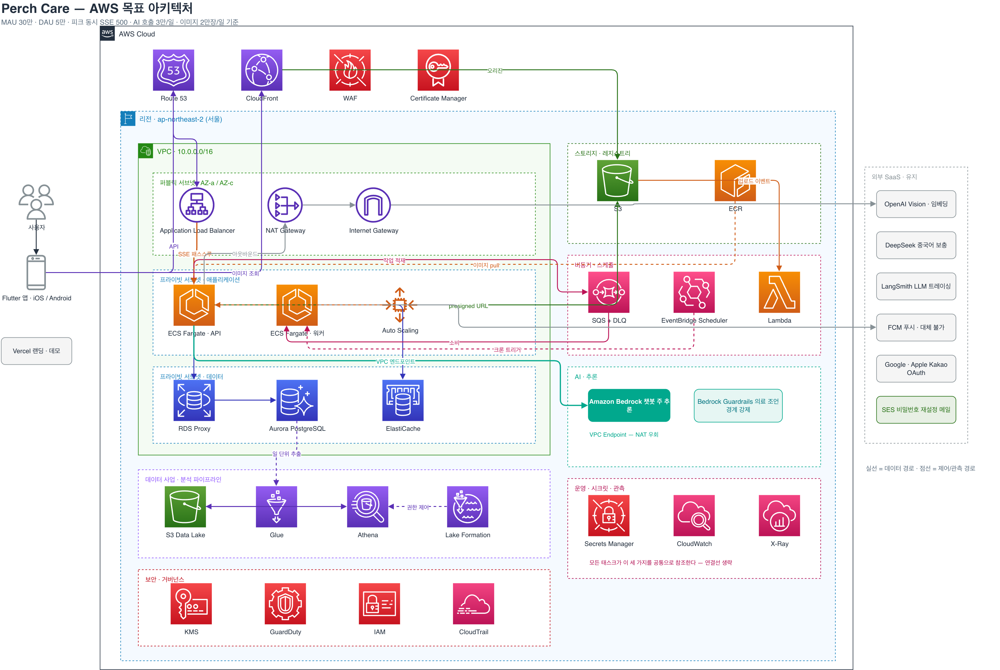

# AI 앱 서비스를 위한 AWS 아키텍처 — 발표용 20장 (Perch Care)

> AWS Student Builder Group · 2026-09 · 임동현
> 실제 발표용 축약본. 전체 원고(Part 1 26섹션 + Part 2 Bedrock 교육 18섹션)는 [2026-09-aws-ai-app-architecture-deck.md](2026-09-aws-ai-app-architecture-deck.md).
> 슬라이드 1장 = `##` 섹션 하나. **20장 고정 · 초과 금지.** `**말할 것**`은 발표 멘트, `> 노트`는 질문 대비용(본문에서 뺀 내용도 여기 보존).

---

## 01. 표지

# AI 앱 서비스를 위한 AWS 아키텍처

실제 운영 중인 서비스 하나를 놓고 — 컴퓨트부터 데이터·LLM까지 설계해보기

2026 · 임동현 · AWS Student Builder Group

**말할 것**
"인스턴스 한 대, 월 $20, p99 32ms. 이게 언제 답이 아니게 될까요?" — 오늘 발표는 이 질문 하나에 숫자로 답하는 자리입니다. 20장, 크게 세 덩어리입니다. 지금 돌아가는 것 → 왜 AWS인가 → AI 앱이라서 갈리는 결정들.

---

## 02. Perch Care 소개

**말할 것**
반려조 건강관리 앱입니다. 기록하면 점수가 나오고, AI에게 물어볼 수 있습니다. AI 호출이 곧 핵심 기능이고 1차 시장이 중국이라서 — "AWS 일반론"이 아니라 "제약이 있는 실제 문제"로 설계를 이야기할 수 있습니다.

| | |
|---|---|
| 무엇 | 체중·식사·음수량 기록 → **Bird Health Index (0–100)** |
| AI | 백과사전 챗봇(앵박사) · 사진 건강체크(Vision) · 주간 인사이트 리포트 |
| 언어 | 한국어 · 영어 · 중국어 |
| 상태 | **App Store 정식 출시** · 1인 개발 · 실사용자 운영 중 · 랜딩 perch.ai.kr |
| 스택 | Flutter · FastAPI · PostgreSQL 17 + pgvector · OpenAI / DeepSeek · LangSmith · FCM |

- 왜 이 앱인가: **AI 호출 = 핵심 기능**, **1차 타겟 = 중국** → 컴퓨트·리전·LLM·규제가 한 서비스 안에서 전부 얽힘

---

## 03. 지금 돌아가고 있는 것 — 계층 지도

**말할 것**
발표 전체의 기준점입니다. 추정이 아니라 저장소 코드에서 그대로 뽑았습니다. 오른쪽 파란 글씨가 근거 파일이고, 주황 테두리 항목은 replica가 2가 되는 순간 깨지는 것들입니다.

| 계층 | 구성 | 코드 근거 |
|---|---|---|
| 클라이언트 | Flutter · Riverpod MVVM · 오프라인 큐 | `sync_service.dart` |

> 노트: "앱 내부 상태" 줄이 뒤에서 계속 등장합니다. replica가 1이라서 지금은 아무 문제가 없고, 2가 되는 순간 전부 깨지는 항목들입니다. 인메모리 레이트리밋 · 인사이트 중복방지 전역 set · StaticFiles 직접 서빙 세 개.

---

## 04. 지금 돌아가고 있는 것 — AI 파이프라인

**말할 것**
AI 부분만 따로 봅니다. 모델이 하나가 아니라 질문 종류·언어에 따라 갈립니다. 중국어 사용자면 DeepSeek를 병렬로 불러 중국 조류 문화·법규를 보충하고, 최종 판단은 GPT가 합니다. 이게 뒤에서 "Bedrock으로 무엇을 옮기고 무엇을 남기나"의 기준이 됩니다.

```
(파이프라인 다이어그램 자리)
```

- **SSE 안전장치**: 쿼터 세션(advisory lock + INSERT + **즉시 COMMIT**) → LLM 스트림 구간엔 **DB 세션 0** → Log 세션(UPDATE). 토큰 0이면 예약 row 삭제 = 쿼터 환원
- **월간 쿼터**: 백과사전 30회(429) · 비전 10회(403) — LLM 비용 안전장치 · **트레이싱**: LangSmith 비동기 사이드카

> 노트: 무음 실패 실사례(본문에서 뺀 내용) — `deepseek_service.py:81`의 모델명 `deepseek-chat`은 2026-07-24 폐기됨(→ `deepseek-v4-flash`). 호출 함수가 실패 시 `None`을 조용히 반환하므로 메인 답변은 정상 생성되고, 중국어 사용자만 문화·법규 보충이 빠진 답을 받습니다. 신호는 로그 warning 한 줄, 알람 0, LLM 실패 메트릭 0. AWS라면 CloudWatch 알람 하나로 당일 발견. 질문 오면 이 사례로 관측 계층을 설명.

---

## 05. 지금 돌아가는 환경 — 비용 · 문제 · 운영

**말할 것**
Railway 한 대입니다. 아래 수치는 2026-09-16 Railway CLI로 직접 측정한 값입니다. "왜 아직 AWS가 아닌가"에 세 열로 답합니다. 대부분의 비교표는 첫 열(비용)만 적고 셋째 열(운영)을 빼먹습니다.

| | 비용 | 문제 | 운영 |
|---|---|---|---|
| **현재** | **$20 / 월** | 시간당 23건 · p99 32ms · CPU ≈ 0% | 운영에 쓰는 시간 **0** · IaC 0 |
| **AWS 최소구성** | **≈ $105 / 월 (5.3배)** | 오토스케일 · LB · 읽기 복제본 → **해결할 문제가 없음** | VPC · SG · ECS · ALB · IAM · CloudWatch **전부 0부터** |
| **해석** | 트래픽이 작을수록 **고정비(NAT)** 비중이 커진다 | 없는 문제에 복잡도를 사는 건 낭비 | PaaS 프리미엄 = **내가 안 써도 되는 YAML의 양** |

**결론: Railway는 타협이 아니라 현재 제약에서의 최적해. 그리고 최적해는 제약이 바뀌면 같이 바뀐다.**

> 노트: AWS $105 내역 — Fargate 0.25vCPU×1 $10 · ALB $18 · RDS t4g.micro $22 · NAT ×1 $45 · S3+CloudFront $3 · ECR/CloudWatch/Secrets $7. NAT가 필요한 이유는 OpenAI·DeepSeek·LangSmith·FCM·OAuth 전부 아웃바운드 필수라서.

---

## 06. 그럼 왜 AWS로 설계하는가 — 설계 기준과 트리거 3개

**말할 것**
트래픽 때문이 아닙니다. 설계 기준은 사업계획서 2028년 5개국 목표에서 유도했습니다. 그리고 실무에서 클라우드를 바꾸는 이유는 대개 시장·계약·규제 쪽입니다. 트리거 세 개를 각각 두 줄로 봅니다.

| 지표 | 설계 기준 | 유도 근거 |
|---|---|---|
| MAU | 300,000 | 다운로드 100만 대비 30% 잔존 |

| 트리거 | 무엇이 걸리는가 | AWS에서 |
|---|---|---|
| **① 시장 진입 — 중국** | Railway 리전은 미국 2 · 유럽 1 · 싱가포르 1 — **한·중·일 없음**. 태평양 왕복 + GFW | 서울 리전 + **중국 별도 파티션**(계정·IAM·ARN 분리). ICP 备案 전제 |
| **② B2B 계약** | 수의사 SaaS·보험 딜이 요구하는 건 돈이 아니라 **문서와 기능** — SLA · 감사 로그 · 키 관리 | CloudTrail · KMS · IAM · Artifact. **Athena·Lake Formation은 Railway에 대응물 자체가 없음** |
| **③ 규제 · 데이터 주권** | 건강 데이터 = 민감 개인정보. PIPL·국내법 모두 "데이터가 어디 있나"를 계약서에 요구 | **리전 선택권**이 곧 대응 수단. S3 수명주기 · Object Lock · KMS 키 폐기 = 파기 증명 |

**트리거 3개의 공통점: 셋 다 "유저가 늘어서"가 아니다.**

---

## 07. AWS 목표 아키텍처 (MAU 30만 기준)

**말할 것**
계층별로 한 줄씩. 색은 세 종류 — AWS 네이티브 / 상태 저장소 / 외부 유지. 마지막 줄 "유지"가 이 발표의 절반입니다. 전부 옮기지 않습니다.

| 계층 | 구성 |
|---|---|
| 엣지 | Route 53 · CloudFront · WAF · ACM |
| 진입 | ALB (SSE 패스스루, deregistration delay 300s) |
| 컴퓨트 | **ECS Fargate** API 태스크 2–12 (ALB 요청수 + CPU 오토스케일) · 워커 태스크 · ECR |
| 데이터 | **Aurora PostgreSQL + pgvector** (writer 1 + reader 1) · **RDS Proxy** · ElastiCache Redis · S3 |
| 비동기 | SQS (+DLQ) · EventBridge Scheduler · **Lambda** |
| AI | **Bedrock** · OpenAI (Vision·임베딩) · DeepSeek · LangSmith |
| 데이터 사업 | S3 Data Lake · Glue · Athena · Lake Formation |
| 운영 | Secrets Manager + SSM · CloudWatch · X-Ray · GitHub Actions + OIDC · CDK (Python) |
| 유지 (외부) | FCM · Vercel · App Store / Play |

- 메인 리전 **`ap-northeast-2` 서울** + 중국 별도 파티션 · 현재 `Dockerfile`은 **한 줄도 안 고치고** Fargate에 올라감
- 컴퓨트 탈락: EKS(컨트롤플레인 $73/월 + 운영 인력, 1인에겐 부채) · App Runner(SSE 장기 연결·VPC 커넥터 제약)

> 노트: 실제 이전 순서(본문에서 뺀 내용) — ① 이미지 → S3 + CloudFront ② DB → Aurora ③ 인메모리 상태 → ElastiCache ④ 앱 → Fargate ⑤ 배치 → EventBridge + SQS + Lambda ⑥ 관측·보안 ⑦ 데이터레이크(B2B 계약 생긴 뒤) ⑧ 중국 파티션(법인·ICP 준비된 뒤). 원칙: 컴퓨트를 옮기기 *전에* 상태를 밖으로 빼고, 각 단계는 독립적으로 가치가 있어 언제든 멈출 수 있어야 함.

---

## 08. 목표 아키텍처 — 전체 구성도

**말할 것**
엣지에서 데이터레이크까지 한 장입니다. 실선이 데이터 경로, 점선이 제어·관측 경로입니다. 오른쪽 아래 데이터레이크는 B2B 계약이 실제로 생긴 뒤에 짓습니다. 먼저 지으면 빈 창고입니다.



> 캡션: 실선 = 데이터 경로 · 점선 = 제어/관측 경로

---

## 09. AI 앱을 AWS에 지을 때 정말 필요한 것

**말할 것**
여기부터가 "AI 앱 서비스를 위한" 부분입니다. 리전·인스턴스 타입 이야기는 안 합니다. AI 앱을 지을 때 결정이 갈리는 지점은 다섯 개고, 남은 슬라이드가 이 다섯 개입니다.

1. **LLM 호출 경로** — 외부 API인가 Bedrock인가. NAT인가 VPC 엔드포인트인가. API 키인가 IAM인가
2. **스트리밍 컴퓨트** — Lambda인가 컨테이너인가. "함수 호출 하나"와 "30초 스트림"은 다른 문제
3. **벡터 · 데이터** — 전용 벡터 DB가 필요한가, Postgres로 충분한가
4. **비동기 AI 작업** — 사용자가 기다리지 않는 LLM 호출을 어디서 돌리나
5. **비용 · 안전 가드** — 쿼터 · 캐싱 · 배치 티어 · Guardrails. 인프라보다 LLM이 비싸지는 지점

> 노트: 5번의 실체(본문에서 뺀 숫자) — MAU 30만이면 인프라 ≈ $1,500(Savings Plan $1,250)인데 AI 호출 일 3만 = 월 90만 건 × $0.002~0.003 ≈ **LLM $1,800+**. 인프라보다 LLM이 비쌉니다. 그래서 비용 최적화의 무게중심은 인스턴스 타입이 아니라 모델 라우팅·캐싱·쿼터·배치/Flex 티어. 이 앱은 이미 셋을 갖고 있음(카테고리별 라우팅·월간 쿼터·advisory lock 직렬화).

---

## 10. Lambda — AI 기능 대부분은 함수 호출 하나다

**말할 것**
AI 기능의 대부분은 입력 하나 → LLM 호출 → 결과 저장으로 끝납니다. 그건 Lambda의 정의 그 자체입니다. 이 앱의 작업을 전부 세워놓고 판정했습니다. 아래 두 줄만 예외입니다.

| 작업 | 트리거 | Lambda? | 이유 |
|---|---|---|---|
| 썸네일 생성 | S3 업로드 이벤트 | ✅ | 1회 · 무상태 · 수 초 |
| 주간 인사이트 생성 (LLM) | SQS | ✅ | 지금 `create_task`로 **사라지는 작업**. Bedrock Flex/배치와 결합 |
| 푸시 팬아웃 | SQS → 배치 | ✅ | 지금 **동기 루프**. 사용자 30만이면 끝나지 않음 |
| 이미지 정리 | EventBridge | ✅ | 아예 **S3 수명주기 30일**로 대체 (코드 삭제) |
| 지식 임베딩 인덱싱 | 문서 업로드 이벤트 | ✅ | 저빈도 · 배치성 |
| 백과사전 챗 SSE 스트림 | HTTP | ❌ **Fargate** | 다음 장 |
| 비전 건강체크 스트림 | HTTP | ❌ **Fargate** | 다음 장 |

> 노트: 과금 감각 — Lambda $0.20/100만 요청 + $0.0000167/GB-초. 일 3만 AI 호출 중 비동기분(인사이트·푸시·썸네일)은 월 수 달러 수준.

---

## 11. Lambda — 스트리밍 API는 왜 Lambda가 아닌가

**말할 것**
Function URL 응답 스트리밍으로 기술적으로는 됩니다. 15분·20MB까지. 그런데도 안 쓰는 이유가 셋이고, 결론은 한 줄입니다.

1. **과금 = 스트림 지속시간 전체** — LLM 응답이 30초면 그 30초 전부 과금. Fargate는 떠 있는 태스크 하나가 동시에 N개 스트림 처리
2. **DB 커넥션 풀을 매 호출 재생성** — RDS Proxy로 완화되지만 근본 성격이 안 맞음
3. **콜드 스타트 = 첫 토큰 지연** — 채팅 UX에서 가장 민감한 구간

**결정 규칙 한 줄: 요청-응답 1회 · 30초 이내 · 무상태 → Lambda / 스트림 · 장기 연결 · 커넥션 풀 → Fargate**

---

## 12. Lambda + Fargate 하이브리드 — 두 경로

**말할 것**
결국 경로가 둘입니다. 사용자가 기다리는 경로와 기다리지 않는 경로. 컴퓨트 모델을 이 기준으로 나누면, 지금 앱 프로세스 안에 있던 것들이 전부 밖으로 나갑니다.

```
(두 경로 다이어그램 자리)
```

- 태스크가 2개가 되는 순간 깨지는 것 3곳은 **ElastiCache**로: 레이트리밋(slowapi 인메모리 → `storage_uri` 한 줄) · 인사이트 중복방지 전역 `set` · Apple 공개키 캐시

> 노트: 비동기 문제 세 얼굴(본문에서 뺀 내용) — ① 사라지는 작업: 주간 인사이트를 요청 안에서 `asyncio.create_task` → 컨테이너 죽으면 소멸 ② 중복되는 작업: 앱 안 APScheduler → 태스크 N개면 N번 실행 ③ 실행 안 되는 작업: 주간 배치 코드가 스케줄러·크론 어디에도 미등록. 원인은 하나 — 앱 프로세스 안에서 돌린다. 그리고 반드시 고칠 것: `CMD alembic upgrade head && uvicorn` → 태스크 12개가 동시에 뜨면 마이그레이션 12번 동시 실행. 배포 전 별도 마이그레이션 태스크로 분리.

---

## 13. Bedrock이란 — 정의와 한 장 구조도

**말할 것**
Bedrock은 지표 아래 단단한 암반이라는 뜻입니다. 그 위에 무엇이든 지을 수 있는 기반. AWS 정의를 그대로 읽으면 이 서비스가 무엇을 파는지가 나옵니다. 모델을 파는 게 아니라 모델 주변을 팝니다.

> "a fully managed service that provides secure, enterprise-grade access to high-performing foundation models from leading AI companies" — AWS Docs

```
(Bedrock 층 구조도 자리)
```

- 읽는 법: **위 두 층(엔드포인트 · 추론)만 있어도 Bedrock을 쓴다.** 나머지는 필요할 때 켜는 것 — 이 앱이 켜는 건 안전·운영 두 층

> 노트: 흔한 오해 3개 — ① "AWS 모델만 있다" ✗ 18개 제공사 100+ 모델(OpenAI GPT-6·Claude 5·DeepSeek V3.2·Qwen3…) ② "SageMaker와 같다" ✗ SageMaker는 내가 모델을 올려 관리, Bedrock은 API ③ "GPT는 없다" ✗ 2026 현재 있음. 상세 이론은 Part 2 교육 자료(B01–B18).

---

## 14. Bedrock에서만 되는 것 — AI 앱 필수 기능

**말할 것**
"모델은 어디서든 부를 수 있다"가 맞습니다. Bedrock을 고르는 이유는 모델 주변에 붙는 이 기능들이고, 하나씩 이 앱의 어디에 쓰이는지 붙였습니다.

| 기능 | 이 앱에서 |
|---|---|
| **Guardrails** — 주제 거부 · PII 마스킹 · 근거 확인 | "수의사에게 가라"는 경계는 기능이 아니라 **안전 요구사항** → 프롬프트가 아니라 인프라 층에서 강제. **`ApplyGuardrail`은 모델 호출 없이 단독 사용 가능** → Bedrock 밖 호출 응답에도 같은 규칙 |
| **크로스리전 추론 프로필** (APAC / Global) | 서울에 in-region으로 없는 모델 호출 · 리전 용량·장애 흡수 |
| **서비스 티어** — Priority(≈1.75×) / Flex(50%↓) | 채팅 첫 토큰 = Priority · 주간 인사이트 = Flex |
| **배치 추론**(50%↓) · **프롬프트 캐싱**(읽기 최대 90%↓) | 리포트·재색인은 배치 · 시스템 프롬프트 + RAG 컨텍스트 반복 구간은 캐싱 |
| **애플리케이션 추론 프로필** | 기능별(백과사전 / 비전 / 인사이트) **비용 태그** → 어느 기능이 돈을 쓰는지 |
| **모델 호출 로깅** → CloudWatch / S3 | 감사 로그 — B2B 계약 요구사항(트리거 ②) |
| **PrivateLink** | 프라이빗 서브넷에서 인터넷 없이 LLM 호출 → NAT 비용 항목 제거 |

---

## 15. 지금 설계 — 무엇을 옮기고 무엇을 남기나

**말할 것**
옮기는 이유는 모델 품질이 아니라 인프라 속성입니다. 그리고 옮기는 데 드는 코드 변경이 얼마나 적은지가 핵심입니다. 반대로 남기는 것에는 각각 이유가 있습니다.

**옮기는 것 — 챗봇 주 추론**

| 인프라 속성 | 효과 |
|---|---|
| VPC 엔드포인트 (PrivateLink) | LLM 호출이 **NAT를 안 탐** → 현재 규모 비용의 43% 항목 제거 |
| IAM 역할 인증 | API 키 0개. 태스크 역할이 곧 권한 |
| CloudWatch 메트릭 · 호출 로깅 | 토큰·지연·오류율 자동 적재 → 감사 로그 |
| Guardrails | 의료 조언 경계를 **코드 밖**에서 강제 |
| **OpenAI 호환 Chat Completions** | `bedrock-runtime.{region}.amazonaws.com/openai/v1` → 기존 클라이언트 **`base_url` 한 줄** 교체 |

**남기는 것 — 각각 이유가 다름**

- **OpenAI Vision · 임베딩**: 3,072차원으로 **2,843 청크 이미 인덱싱** → 모델 교체 = 전체 재색인 + 임계값 재튜닝. 게다가 `text-embedding-3` 계열은 **Bedrock에 대응 모델이 없음** = 선택이 아니라 제약
- **LangSmith**: LLM 트레이스(프롬프트·토큰·체인)는 CloudWatch가 대체 못 함. X-Ray는 인프라 구간(ALB→DB) 담당 — 역할이 다름 · **FCM · Vercel**: 대체 불가 / 대체 불필요

---

## 16. 문제점 ① — 중국 파티션에는 Bedrock이 없다

**말할 것**
1차 타겟이 중국인데, 이건 "리전을 하나 추가"하는 문제가 아닙니다. AWS 중국은 별도 파티션이고, 그래서 LLM 전략이 파티션별로 갈립니다.

| 항목 | 글로벌 AWS | AWS 중국 |
|---|---|---|
| 계정 · 운영 주체 | 기존 계정 · AWS | **완전히 별도 계정** · 중국 법인 필요 · 베이징 Sinnet / 닝샤 NWCD |
| IAM · ARN | `arn:aws:` | **크로스 파티션 불가** · **`arn:aws-cn:`** → IaC 코드가 그대로 안 돎 |
| Bedrock | 사용 가능 | **미제공** → LLM 경로가 갈림 |
| 데이터 이전 | 자유 | PIPL · 건강 데이터 국외 이전 별도 절차 → 중국 데이터는 중국 안에 |

```
(파티션별 LLM 경로 자리)
```

- 정리: **글로벌은 Bedrock, 중국은 DeepSeek 직접 API.** 코드는 한 벌이지만 **LLM 경로와 IaC는 두 벌**이 된다

---

## 17. 문제점 ② — "자체 운영 AI 서비스"여야 한다

**말할 것**
중국 배포와 B2B 실사에서 같은 질문을 받습니다. "AI가 데이터를 어디로 보내나요?" 외부 LLM API를 직접 부르는 구조에서는 이 답이 제공자 수만큼 갈라집니다. 앱은 자기가 운영하는 AI 서비스로 설명돼야 하고, 그걸 사실로 만들어 주는 게 Bedrock입니다.

| 요구 | 외부 LLM API 직접 호출 | Bedrock |
|---|---|---|
| "AI 데이터가 어디로 가나" | 제공자마다 국가·목적을 따로 고지 → 답이 여러 갈래 | 추론이 **내 AWS 계정·리전 안**에서 실행 → **한 갈래** |
| 국외 이전 · 제3자 제공 항목 | AI 제공자별로 항목이 늘어남 | AWS 한 곳, 리전 하나(서울 / APAC Geo) — **한 줄** |
| 증명 | 제공자 약관을 첨부하는 수준 | **CloudTrail + 모델 호출 로깅**으로 "누가 언제 무엇을" 제출 가능 |
| 데이터 보존 | 제공자 정책에 종속 | **retention mode**로 내가 선택(저장 안 함 포함) · Model Deployment Account 구조상 제공사 접근 불가 |

- 규제 대응에서 Bedrock의 가치는 모델이 아니라 **"AI도 같은 처리자, 같은 리전"**이라고 문서에 쓸 수 있게 되는 것
- 단, 남기는 Vision·임베딩은 별도 고지가 필요 → **옮기지 않는 항목의 규제 비용**. 대신 `ApplyGuardrail`로 안전 규칙만은 두 경로에 동일하게

---

## 18. 왜 전용 벡터 DB를 안 쓰나

**말할 것**
RAG 발표에서 가장 자주 나오는 질문입니다. 답은 "벡터 DB"가 제품 카테고리가 아니라 규모·조회 패턴·JOIN 필요성으로 정하는 것이라서입니다. 네 선택지를 이론부터 놓고 비교합니다.

| 선택지 | 무엇인가 (이론) | 판정 · 근거 |
|---|---|---|
| **Aurora PostgreSQL + pgvector** | 관계형 DB 안의 벡터 타입 + **HNSW** 근사 최근접 인덱스. 벡터가 테이블의 한 열이라 트랜잭션·SQL이 그대로 적용 | ✅ **선택** — 청크 **2,843건**. 무엇보다 **유저·펫 데이터와 JOIN**이 됨. 분리하면 그 능력을 잃고 앱에서 조합해야 함 |
| OpenSearch Serverless | 분산 검색 엔진(Lucene 계열). 샤딩·복제로 수평 확장, **BM25 키워드 + 벡터 하이브리드** 검색이 강점 | ❌ 최소 OCU **고정비**(월 수백 $) + JOIN 상실. **전환 트리거: 청크 100만 건 또는 하이브리드 검색 요구** |
| S3 Vectors | 오브젝트 스토리지에 벡터 인덱스를 두는 **콜드 계층**. 메모리 상주를 포기하고 100ms급 지연을 받아들이는 대신 저장비가 압도적으로 싸다 | ❌ 지금은 — 최대 90% 저렴하지만 저빈도 조회용. 나중에 오래된 청크 **아카이브** 후보 |
| Bedrock Knowledge Bases | 관리형 RAG. 문서 인제스트 → 파싱 → 청킹 → 임베딩 → 검색 → 리랭킹을 AWS가 운영(커넥터·인용 제공) | ❌ 직접 구현한 **HyDE → 임베딩 → HNSW → 리랭킹**을 통째로 포기 = 차별점을 관리 편의와 교환 |

- 구성: writer 1 + reader 1, 리포트 조회는 리더 엔드포인트. **RDS Proxy가 핵심** — Fargate 태스크 12개 × SQLAlchemy 풀 = Aurora 커넥션 한도. 코드는 이미 스트리밍 중 세션을 놓아주고, Proxy가 인프라 층에서 한 번 더 받침
- 필요해지면 **Customer-managed KB on Aurora**가 기존 pgvector를 그대로 쓰는 진입점 — 지금 선택이 미래를 닫지 않는다

---

## 19. 정리

# AI 서비스의 아키텍처를 정하는 건 트래픽이 아니라 **시장과 계약**이었습니다.

오늘 가져갈 것 세 줄:
1. **스트림은 Fargate, 이벤트는 Lambda** — "함수 호출 하나"와 "30초 스트림"은 다른 문제
2. **Bedrock은 모델이 아니라 인프라 속성 때문에 쓴다** — IAM · VPC 엔드포인트 · Guardrails · 호출 로깅
3. **벡터 DB는 JOIN이 필요한 동안 Postgres** — 규모·조회 패턴이 바뀌면 그때 옮긴다

> 노트: 한 줄 더 남는다면 — 인프라보다 LLM이 비싼 앱에선 비용 최적화의 무게중심이 인스턴스 타입이 아니라 캐싱 → 배치 → Flex → Global 순서입니다. MAU 30만 기준 인프라 $1,250 vs LLM $1,800+.

---

## 20. 감사합니다

perch.ai.kr · AWS Student Builder Group

**말할 것**
질문 받겠습니다. Bedrock 이론(엔드포인트·추론 프로필·Guardrails·Knowledge Bases·AgentCore·데이터 보호·비용 5축)은 별도 교육 자료 18장으로 준비돼 있습니다.
